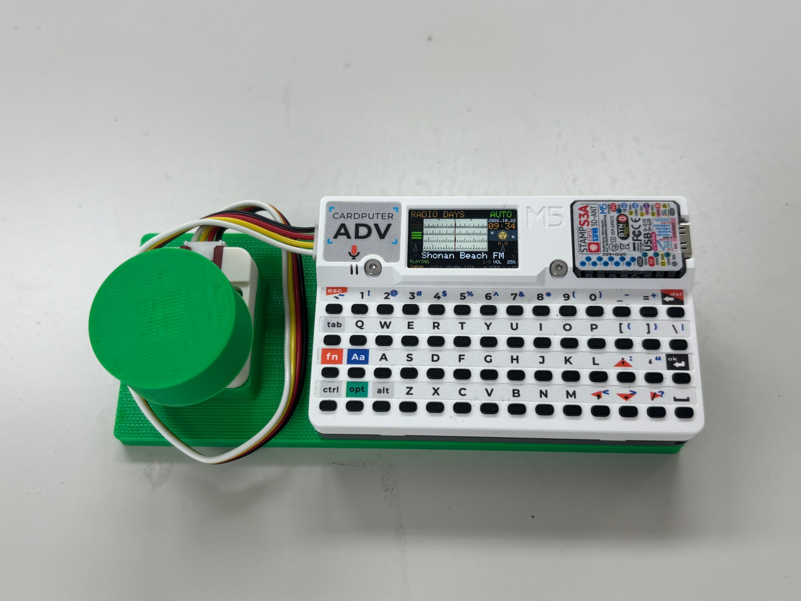
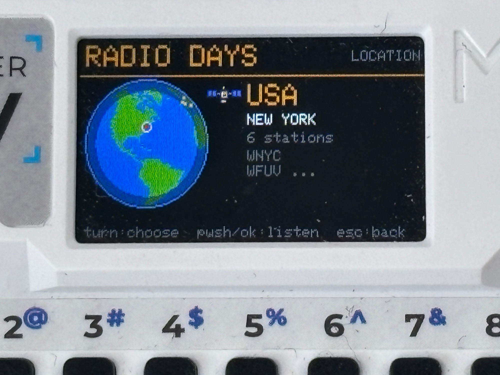
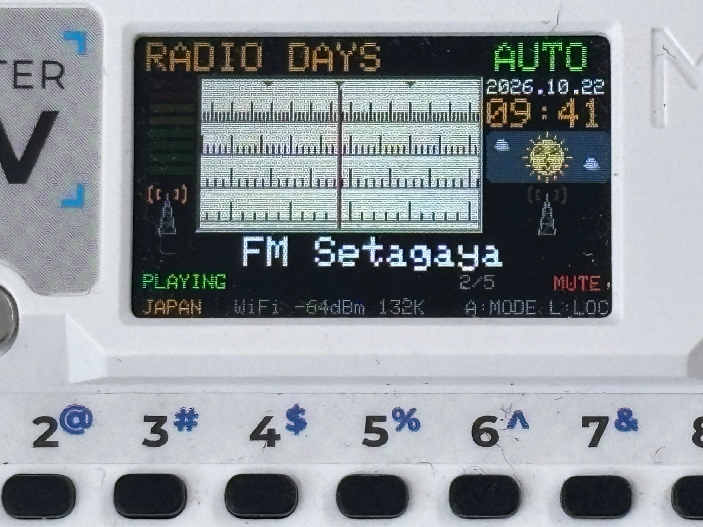
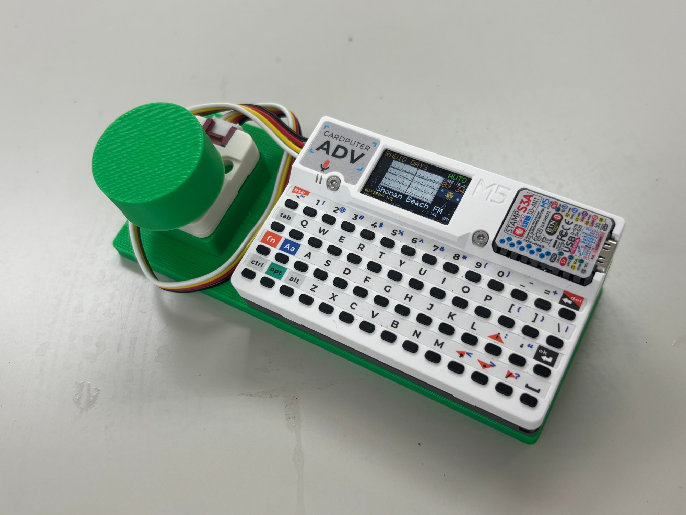

# RADIO DAYS

**21st Century Radio Magic**  
*Turn the dial. Rediscover your world.*

**English | [日本語](README_JP.md)**

Long before the internet became part of everyday life, **radio was already connecting the world.**

Turn the dial, and through the hiss of static a voice from somewhere far away begins to emerge. Nudge the tuning a little further, and the signal comes into focus. You never quite knew what you might find. That was half the fun.

In the 1980s, there were kids who lived for shortwave listening (BCL) and FM radio. They dreamed of receivers like the Sony ICF-2001, leafed through *FM STATION* magazine, and imagined the places those distant voices came from.

More than forty years later, the internet lets us listen to stations around the globe with a few clicks. But searching for a station and pressing Play doesn't quite recreate the pleasure of turning a tuning dial.

Then one day, while turning the dial on my own **[Cardputer ADV Media Jog](https://github.com/kariagepompadour/Cardputer-ADV-Media-Jog)**, an idea struck me:

**“What if I could tune a radio with this dial?”**

The radios I loved growing up and the little computer on my desk suddenly came together.

That was the beginning of **RADIO DAYS**.

Not a replica of an old radio, but an attempt to build the radio a twentieth-century radio kid might have dreamed of—with twenty-first-century technology. A tiny internet radio for turning a dial, exploring the airwaves, and stumbling upon something unexpected.

Read more about the inspiration and design principles in [docs/concept.md](docs/concept.md) (Japanese).



## What makes it RADIO DAYS?

- **Tune, don't just tap:** Turn a rotary encoder to find stations. AUTO and MANUAL tuning—and the static between stations—are part of the experience.
- **Travel by radio:** Choose from seven Locations on a globe. The default lineup contains 42 stations, personally selected by the maker—not a popularity ranking.
- **An old-school dial:** An ivory four-row tuning scale, fixed pointer, station markers, LED-style level meter, and two little radio towers whose signals blink alternately.
- **A world on the screen:** Local time for each Location's representative city, a day and night sky, the sun and moon. WORLD uses Japan time.
- **Two ways to listen:** The Cardputer's own 2.4 GHz Wi-Fi—no computer needed—or a USB relay, in which a Mac receives the stream and passes the MP3 data to the Cardputer over USB.
- **Make it yours:** Edit the station and Location definitions in the source, then rebuild the firmware.





## What you need

- **M5Stack Cardputer ADV.** Keyboard controls are available even without an encoder.
- **M5Stack Unit Encoder (U135)** for dial control, connected to the Cardputer ADV Grove port. No extra soldering or electronics work is required.
- **A way to receive streams:** compatible 2.4 GHz Wi-Fi (the Cardputer alone is enough), or a USB connection to a Mac running the macOS-only relay script.
- **Optional 3D-printed stand and knob.** The application works without them.

## Installing U10

**U10 is the only firmware version distributed in this repository.** Earlier firmware versions (U1–U9) are kept in the author's local development archive, not published here. Two files are provided in [`firmware/RadioDays_U10/`](firmware/RadioDays_U10/), one for each installation method. **Choose one method; the two files are not interchangeable.**

| | A. M5Burner (full flash) | B. Launcher (keeps your other apps) |
| --- | --- | --- |
| File | [`RadioDays_U10.ino.merged.bin`](firmware/RadioDays_U10/RadioDays_U10.ino.merged.bin) | [`RadioDays_U10.ino.bin`](firmware/RadioDays_U10/RadioDays_U10.ino.bin) (app-only) |
| What it does | Replaces everything on the Cardputer's flash with RADIO DAYS | Adds RADIO DAYS as one app in the Launcher |
| Launcher and other apps | **Overwritten** | Kept |
| Size / SHA-256 | 4,194,304 B / `940735c5…92303` | 1,371,360 B / `f6c4d40d…70e61` |

The full SHA-256 values are in [THIRD_PARTY_NOTICES.md](THIRD_PARTY_NOTICES.md); the app-only file is also listed in [`SHA256SUMS.txt`](firmware/RadioDays_U10/SHA256SUMS.txt).

### A. Install with M5Burner

[M5Burner](https://docs.m5stack.com/en/download) is M5Stack's flashing tool. It writes `RadioDays_U10.ino.merged.bin`, a complete image (bootloader, partition table and app), from address 0x0.

> **Warning:** Flashing a full image **erases the M5Stack Launcher and every app installed through it**. Use method B if you want to keep them.

1. Connect the Cardputer ADV to your computer with a USB data cable.
2. In M5Burner, select the Cardputer category and search for **RADIO DAYS**.
3. Download it and burn it to the Cardputer's serial port. When it finishes, restart the Cardputer; RADIO DAYS starts directly, with `U10` at the top right of the START screen.

Saved Wi-Fi networks and the saved Location may not survive a full flash; set them again if needed.

The author has registered RADIO DAYS on M5Burner and confirmed that flashing the merged binary through M5Burner over USB starts and runs RADIO DAYS. RADIO DAYS U10 was **published on M5Burner on 2026-10-22**. If you cannot find it, `RadioDays_U10.ino.merged.bin` from this repository is a standard ESP32-S3 full image to be written at address **0x0**; flashing it with tools other than M5Burner has not been tested by the author.

It was built with *Flash Size: 4MB* and *Partition Scheme: Huge APP (3MB No OTA/1MB SPIFFS)*; see [THIRD_PARTY_NOTICES.md](THIRD_PARTY_NOTICES.md) for all build settings.

### B. Install as an app with the Launcher

This method uses the community [M5Stack Launcher](https://github.com/bmorcelli/Launcher) (tested with **Launcher 2.9.1**) and keeps your other apps.

1. Check the file: `shasum -a 256 -c SHA256SUMS.txt` in `firmware/RadioDays_U10/` must report `OK`.
2. In the Launcher's partition manager (**PMan**), check that **FREE is at least 1,376,256 bytes (0x150000)**.
3. Install the **app-only** `RadioDays_U10.ino.bin`, either from an SD card or via the Launcher's Wi-Fi upload (WebUI).
4. **If a screen starting with “Need …” appears, choose “Cancel”.** The other choice can overwrite an existing app.
5. The Launcher restarts and opens RADIO DAYS. To return to the Launcher, restart the Cardputer and press a button on the Launcher's boot screen.

**Do not install `RadioDays_U10.ino.merged.bin` through the Launcher**, and do not use the Arduino IDE *Upload* command or `esptool` if you want to keep the Launcher—these write directly to flash.

## Listening

### Over Wi-Fi (Cardputer only)

Wi-Fi playback needs **only the Cardputer ADV and a 2.4 GHz network**: no computer and no relay.

1. At the START screen, press `W`, select a network, and enter its password.
2. Up to **three** successfully connected networks are saved. On subsequent starts, the most recently used network is tried first (12 seconds per attempt; 30 seconds total).
3. In the `W` network list, press `S` to see saved networks and connect or delete them.

Wi-Fi supports **2.4 GHz** networks, including password-protected networks (such as WPA2) and open networks. **Hidden SSIDs are not supported.**

### Through a Mac USB relay

Use this where the Cardputer cannot join a Wi-Fi network. A Mac receives the stream with its own network connection and passes the MP3 data to the Cardputer over USB. You need the relay script **[`tools/usb-relay/RadioDaysRelay_U9.command`](tools/usb-relay/RadioDaysRelay_U9.command)**.

**Getting the script** (one of these):

- Download the whole repository (**Code → Download ZIP** on GitHub, or `git clone`) and open `tools/usb-relay/`.
- Or download only the script: open it on GitHub and choose **Download raw file**, or run

  ```bash
  curl -LO https://raw.githubusercontent.com/kariagepompadour/RADIODAYS/main/tools/usb-relay/RadioDaysRelay_U9.command
  ```

**Before you start:** connect the Cardputer to the Mac with a USB **data** cable and start RADIO DAYS. Close any other program using the Cardputer's serial port (for example the Arduino IDE Serial Monitor).

**Starting the relay:**

1. Open Terminal in the folder containing the script and run:

   ```bash
   perl RadioDaysRelay_U9.command
   ```

   This works for a downloaded file as it is. Alternatively, double-click the file in Finder; a single downloaded file may first need `chmod +x RadioDaysRelay_U9.command`, and if macOS refuses to open a downloaded file, use the `perl` command above.
2. The relay finds the Cardputer (`/dev/cu.usbmodem…`) by itself. If several USB serial ports are present, it asks you to type the number of the Cardputer's port.
3. On the Cardputer START screen, press `U` (if no Wi-Fi network has been saved, any key or the knob starts the radio). Starting with `U` disables Wi-Fi for that session.
4. Until the relay answers, the screen shows `USB RELAY REQUIRED` / `Start the relay on your computer.`
5. To stop the relay, press Control-C or close the Terminal window.

**The U9 filename is intentional: `RadioDaysRelay_U9.command` is also the relay used by U10** (the text inside the script says U9; U10 uses the same link protocol and stations). The script uses Perl, curl, and caffeinate included with macOS, keeps the Mac awake while it runs, and accepts only the hosts of the default stations. **Windows and Linux are not supported and have not been tested.** No Mac Internet Sharing or network configuration changes are needed.

### Controls

**Radio screen**

| Action | Encoder (U135) | Keyboard |
| --- | --- | --- |
| Tune | Turn the knob. **AUTO:** the dial glides to the next / previous station. **MANUAL:** the dial moves in small steps, with static between stations | `,` / `/` (also `P` / `N`): one step down / up |
| Switch AUTO / MANUAL | — | `A` (every start is AUTO) |
| Volume | Hold the knob down and turn it | `;` up / `.` down |
| Mute on / off | Short press | `M` |
| Choose a Location | — | `L` opens the globe: turn the knob (or `,` `/`) to choose, press the knob or `ok` to listen, `esc` to go back |
| Wi-Fi setup | — | `W` |
| Diagnostic line on / off | — | `I` |

**START screen:** `W` Wi-Fi setup, `U` USB relay only, any other key or a knob press starts the radio.

### Stations, Locations and the clock

- Your Location selection is saved. Without a saved Location, the first station is Radio Paradise in WORLD. A previously saved Location that no longer exists in U10 also falls back to WORLD.
- A display such as `3/7` means station three of seven in the current Location; it is **not** a popularity rank. The number is hidden while AUTO is moving and when MANUAL is between stations.
- The clock is set from the internet (NTP) over Wi-Fi, or from the Mac's clock (UTC) through the USB relay. It shows `--:--` until the time has been received.

### Default station lineup

| Location | Stations |
| --- | ---: |
| JAPAN | 5 |
| USA | 6 |
| UK | 7 |
| FRANCE | 7 |
| WORLD | 6 |
| GERMANY | 6 |
| ITALY | 5 |
| **Total** | **42** |

Station definitions are in [`stations.h`](firmware/RadioDays_U10/stations.h). Selection notes appear in [docs/u9-implementation-plan.md](docs/u9-implementation-plan.md), section 2 (Japanese).

## Current status and limitations

**U10 (2026-10-22)** adds the ivory tuning face, recessed border, and two radio towers to U9. During PLAYING, the towers flash alternately every 0.8 seconds.

| Item | Status |
| --- | --- |
| Build, host tests on a Mac | Done ([docs/usb-u10.md](docs/usb-u10.md), Japanese) |
| USB-relay playback and screen design on a Cardputer ADV | **Checked on hardware by the author** |
| Installing `merged.bin` with M5Burner over USB, start-up and operation | **Checked on hardware by the author** |
| Installing the app-only `.bin` with the Launcher | Same procedure as earlier versions (checked up to Stage 2-1); not separately recorded for U10 |
| Wi-Fi playback with U10 | **Not recorded as tested** |
| Long-term stability | **Not verified** |

The comment at the top of `RadioDays_U10.ino` still reads “Not yet run on hardware”. The U10 source is kept unchanged as a fixed version (it is covered by `SHA256SUMS.txt`), so this README and [docs/usb-u10.md](docs/usb-u10.md) record the current status. The control list in that comment also dates from an earlier stage; use the table above.

- Only **MP3 streams over `http://`** are supported. HTTPS, HLS, AAC, and `.m3u` / `.pls` playlists are not supported.
- Audio may drop out when a station does not supply data fast enough. Recovery can occur automatically, but this issue is not resolved.
- The 42 default stream URLs were mainly checked for server responses from a Mac; **most have not been verified playing on the Cardputer itself**. Stream URLs may change without notice.
- Except for RNZ, it has not been established whether the URLs were officially published by their stations. **Station usage terms have not been verified.** A stream being technically accessible does not establish permission to use it (see [docs/usb-u4.md](docs/usb-u4.md) and [docs/usb-u9.md](docs/usb-u9.md)).
- When using the USB relay at work or in a shared environment, follow local policies for USB devices and audio streaming.
- The app-only binary size limit is **0x150000 (1,376,256 bytes)**. U10 is **1,371,360 bytes**, leaving **4,896 bytes**.

## Building from source

| Item | Version / setting |
| --- | --- |
| Arduino IDE board package | **M5Stack `m5stack:esp32` 3.3.9** (ESP-IDF v5.5.4), board **M5Cardputer** |
| Libraries | **ESP8266Audio 2.4.1**, **M5Cardputer 1.1.1**, **M5Unified 0.2.25**, **M5GFX 0.2.32** |
| USB Mode / USB CDC On Boot | **Hardware CDC and JTAG** / **Enabled** (the sketch stops with `#error` otherwise) |
| App-only `.ino.bin` (Launcher) | Flash Size **8MB**, Partition Scheme **8M with spiffs (3MB APP/1.5MB SPIFFS)** (for the size check; the Launcher makes the real partition). Use *Sketch → Export Compiled Binary* |
| Full image `.ino.merged.bin` (M5Burner) | Flash Size **4MB**, Partition Scheme **Huge APP (3MB No OTA/1MB SPIFFS)** |

These are the versions used for the distributed binaries. Newer library versions may also work but have not been tested; the build may then differ in size. A rebuilt binary is not expected to be byte-identical, because file paths of the build machine are embedded. The Arduino IDE also writes a `build/` folder inside the sketch folder; it is excluded by `.gitignore`.

## Customizing stations and Locations

The default lineup is the maker's selection. You can replace stations or add Locations, but **you must edit the source and rebuild the firmware** (see [Building from source](#building-from-source)). Background research (Japanese, written for the earlier U8 with 19 Locations; the steps below are for U10): [docs/station-customization-review.md](docs/station-customization-review.md).

1. **Find a compatible stream.** Use direct MP3 streams over `http://` only, at 192 kbps or less (the maker's policy). HTTPS, HLS (`.m3u8`), AAC, and `.m3u` / `.pls` playlists are unsupported. Prefer URLs published by the station and check its terms of use.
2. **Edit [`stations.h`](firmware/RadioDays_U10/stations.h).** One entry per station: `{"Station name", "City", "http://…", freq},`. Station names must be ASCII, at most 19 characters; accented characters and Japanese are unsupported. The city field is for records and is not shown on screen.
3. **Recalculate frequencies when the station count changes.** Run, for example, `python3 tools/freq-calc/freq_calc.py 6` to obtain `810, 830, 850, 870, 890, 910`. Update **all** `freq` values in that Location. Array order determines dial order and the `n/N` station number.
4. **Add a Location after WORLD.** The definition includes an uppercase ASCII name (up to seven characters), city, latitude/longitude, `true`, `800`, `RD_DIAL_MAX(table)`, table, `RD_COUNT(table)`, and time zone. Do not change the names or positions of the first five Locations (JAPAN, USA, UK, FRANCE, WORLD). Update the `LOCATION_COUNT == 7` check at the end of `stations.h`.
5. **Build and check the size.** Invalid frequencies, overly long names, and inconsistent Location counts stop the build with an error. Keep the binary within 1,376,256 bytes.
6. **Update the USB relay allowlist if needed.** Create `tools/usb-relay/allowed_hosts.txt`, with one `host:port` per line; for variable redirect hosts, use `redirect *.example.com:80`. **A custom allowlist replaces the built-in list**, so include existing stations' hosts as well. Check URLs with `perl tools/usb-relay/RadioDaysRelay_U9.command --check-url <URL>` or `--check-redirect <URL>`. IP-address URLs and URLs longer than 300 characters are rejected.
7. **Redistributing a modified binary?** Follow the GPL license terms below.

## Optional 3D-printed parts



The stand and knob are **the very same parts** used in my earlier **[Cardputer ADV Media Jog](https://github.com/kariagepompadour/Cardputer-ADV-Media-Jog)** project. The STL and 3MF describe the same geometry; the designer printed them and tested them with the real hardware. Find them in the Media Jog repository's `hardware/` directory (MIT License); they are not duplicated here.

- `hardware/MediaJog_Base_A.stl` — flat base
- `hardware/MediaJog_Base_B.stl` — 15° inclined base
- `hardware/MediaJog_Dial.stl` — tuning knob
- `hardware/Cardputer-ADV-Media-Jog.3mf` — Bambu Studio project

RADIO DAYS works without these printed parts.

## Documentation

Most design and development notes are **in Japanese**.

- [Concept and design principles](docs/concept.md)
- [Design specification](docs/design.md) and [development plan](docs/development-plan.md)
- [U10 implementation and test notes](docs/usb-u10.md) and [U9 station/USB-relay notes](docs/usb-u9.md)
- [Station customization background research](docs/station-customization-review.md) (written for U8; the README steps above are current)
- [Third-party notices and binary license](THIRD_PARTY_NOTICES.md)
- [Changelog](docs/CHANGELOG.md) and [release preparation plan](docs/release-plan.md)

<details>
<summary>Full archive of design, research, and development notes (expand)</summary>

The table below retains the original Japanese descriptions of historical records. **Statements such as “not hardware-tested” refer to those historical stages, not necessarily the current U10 status.**

| 資料 | 内容 |
| --- | --- |
| [docs/concept.md](docs/concept.md) | **コンセプト**（作品の背景、キャッチコピー、設計の原則） |
| [docs/design.md](docs/design.md) | 設計書（調査結果、方式、画面・操作、Launcher、NVSの合格条件） |
| [docs/development-plan.md](docs/development-plan.md) | 開発計画（Stage 1〜4、各段階の確認と判定基準） |
| [docs/stage-3-3.md](docs/stage-3-3.md) | **Stage 3-3：太陽と月、昼夜の空、UFO** |
| [docs/usb-u10.md](docs/usb-u10.md) | **U10：アイボリーの文字盤、縁取り、電波塔。USB中継での動作と画面デザイン、M5Burnerでのmerged.binの書き込みを作者が実機で確認（Wi-Fiでの再生と長時間の安定性は未確認）** |
| [docs/dial-face-tower-proposal.md](docs/dial-face-tower-proposal.md) | U10の設計（A案・B案、電波塔、プレビュー。B案を採用） |
| [docs/usb-u9.md](docs/usb-u9.md) | **U9：標準の7 Location・42局、選局番号 n/N、U9の中継。実機は未確認** |
| [docs/u9-implementation-plan.md](docs/u9-implementation-plan.md) | U9の実装計画（局の表、表示、容量、中継、試験の項目） |
| [docs/location-selection-review.md](docs/location-selection-review.md) | 標準の収録国の再検討（6か国＋WORLD） |
| [docs/uk-station-selection-review.md](docs/uk-station-selection-review.md)、[japan](docs/japan-station-selection-review.md)、[usa](docs/usa-station-selection-review.md)、[france](docs/france-station-selection-review.md)、[germany](docs/germany-station-selection-review.md)、[italy](docs/italy-station-selection-review.md) | 各国の選局の調査（聴取率、配信、再生、利用条件） |
| [docs/station-customization-review.md](docs/station-customization-review.md) | 利用者による放送局の追加・変更の背景調査（U8時点。U10の手順はREADME） |
| [docs/station-lineup-survey-plan.md](docs/station-lineup-survey-plan.md)、[docs/ranking-dial-feasibility.md](docs/ranking-dial-feasibility.md)、[docs/cardputer-adv-radiko-review.md](docs/cardputer-adv-radiko-review.md) | 選局の方針と調査の計画、順位の調査（参考）、Cardputer-Adv-Radikoの技術調査 |
| [docs/usb-u8.md](docs/usb-u8.md) | **U8：AUTOでスケールが次の局まで流れる。実機は未確認** |
| [docs/japan-stations-review.md](docs/japan-stations-review.md) | JAPANの7局の調査と評価（局は未変更） |
| [docs/japan-candidates-review.md](docs/japan-candidates-review.md) | JAPANの代わりの候補の調査と比較（局は未変更） |
| [docs/japan-popular-stations-review.md](docs/japan-popular-stations-review.md) | 知名度を優先した日本の主要局と、radikoの利用方法の調査（局は未変更） |
| [docs/usb-u7.md](docs/usb-u7.md) | **U7：時計をLocationの現地時刻に。実機は未確認** |
| [docs/auto-glide-proposal.md](docs/auto-glide-proposal.md) | AUTOの選局アニメーションの調査・提案（U8で実装） |
| [docs/clock-local-time-proposal.md](docs/clock-local-time-proposal.md) | 時計の現地時刻化と昼夜判定の調査・提案（U7で実装） |
| [docs/usb-u6.md](docs/usb-u6.md) | **U6：等間隔4段・循環式・枠付きのダイヤル。実機は未確認** |
| [docs/usb-u5.md](docs/usb-u5.md) | **U5：固定指針・可動スケールのアナログダイヤル（数字なし）、最下行の修正。実機は未確認** |
| [docs/analog-dial-proposal.md](docs/analog-dial-proposal.md) | U5の設計（第1〜3部、承認済み） |
| [docs/usb-u4.md](docs/usb-u4.md) | **U4：昼の空、USB待機の案内、国別Location（19か所・85局）、人工衛星、Wi-Fiの3件保存。実機は未確認** |
| [docs/u4-proposal.md](docs/u4-proposal.md) | U4の設計（承認済み） |
| [docs/usb-u3.md](docs/usb-u3.md) | **U3：USBだけのときも時計・太陽・月（Macから時刻）。作者が正常動作を確認（保存版）** |
| [docs/usb-u3-time-design.md](docs/usb-u3-time-design.md) | U3の設計（承認済み） |
| [docs/usb-u2a4.md](docs/usb-u2a4.md) | **U2a4：Wi-FiなしでもUSB中継で聴ける、Uキー（実機は未確認）** |
| [docs/release-plan.md](docs/release-plan.md) | **完成・公開までの残作業（A：必須、B：推奨、C：公開後）** |
| [docs/usb-u2a3.md](docs/usb-u2a3.md) | **U2a3：UFOの浮遊と交信、プログラム容量の調査（実機試験合格）** |
| [docs/usb-u2a2.md](docs/usb-u2a2.md) | USB接続 U2a2：U2aの調査と修正（**実機試験済み**） |
| [docs/usb-u2a.md](docs/usb-u2a.md) | **USB接続 U2a（USB中継での選局）：実装、試験の結果、実機の手順（実機は未確認）** |
| [docs/usb-u2a-design.md](docs/usb-u2a-design.md) | USB接続 U2aの設計（第2版、承認済み） |
| [docs/usb-u2-design.md](docs/usb-u2-design.md) | USB接続 U2の設計案（決定前） |
| [docs/usb-u1.md](docs/usb-u1.md) | USB接続 U1（USBシリアル中継の試作。**実機で動作確認済み**）：手順と結果 |
| [docs/usb-relay-design.md](docs/usb-relay-design.md) | **USB接続方式の再検討（KariPomとの比較、USBシリアル中継の設計）** |
| [docs/usb-connection-research.md](docs/usb-connection-research.md) | Wi-FiのないときのUSB接続（第1回の調査） |
| [docs/stage-3.md](docs/stage-3.md) | Stage 3-1・3-2：WORLD RADIO（Location、地球儀）。操作とテスト項目 |
| [docs/stations.md](docs/stations.md) | **放送局の一覧と確認記録、周波数の割り当て（判断待ち）** |
| [docs/stage-2-5.md](docs/stage-2-5.md) | Stage 2-5：時計とムーンフェイス |
| [docs/stage-2-4.md](docs/stage-2-4.md) | Stage 2-4（実機で動作確認済み）：レベルメーター、放送局についての調査 |
| [docs/stage-2-3.md](docs/stage-2-3.md) | Stage 2-3：AUTO／MANUAL、ノイズ |
| [docs/stage-2-2.md](docs/stage-2-2.md) | Stage 2-2（実機で動作確認済み）：選局の仕組み |
| [docs/stage-2-1.md](docs/stage-2-1.md) | Stage 2-1 試作版（実機で動作確認済み）：導入手順、操作、確認項目 |
| [docs/stage-2-0-size.md](docs/stage-2-0-size.md) | Stage 2-0 容量の試作の結果 |
| [docs/CHANGELOG.md](docs/CHANGELOG.md) | 変更履歴 |
| `tools/make_globe_land.py` | 地球儀の地図を作るスクリプト |
| `tools/usb-relay/` | USB中継スクリプト（`RadioDaysRelay_U9.command`、`allowed_hosts.txt` で許可ホストを指定） |
| `firmware/RadioDays_U10/`、`tools/u10-test/`、`tools/u10-preview/`、`tools/freq-calc/` | U10（`run_u10_test.sh`：文字盤・残像・電波塔の試験。`make_u10_preview.sh`：U10のコードで描いた画面の見本。`make_face_tower_preview_u10.py`：文字盤・電波塔の設計プレビュー。`freq_calc.py`：`freq` の計算）。**`tools/u10-test/` と `tools/u10-preview/` は公開していない旧版（`firmware/RadioDays_U9/`、`tools/u9-test/`、`tools/dial-preview/`）を使うため、作者の開発環境でのみ動きます** |

</details>

## License

- **Source code** written for RADIO DAYS (`.ino`, `.h`, scripts and tools): MIT License ([LICENSE](LICENSE)). Copyright (c) 2026 kariagepompadour.
- **Compiled binaries** (`RadioDays_U10.ino.bin` and `RadioDays_U10.ino.merged.bin`): they include ESP8266Audio 2.4.1 (with libmad), licensed under GPL-3.0-or-later, so the binaries are distributed under **GPL-3.0-or-later** ([license text](LICENSES/GPL-3.0-or-later.txt)). The Corresponding Source is the firmware source in this repository, the verbatim ESP8266Audio copy in [`third-party/ESP8266Audio-2.4.1/`](third-party/ESP8266Audio-2.4.1/), and the libraries and build settings listed in [Building from source](#building-from-source). The build uses the ESP8266Audio installed by the Arduino Library Manager; the bundled copy is identical. The same GPL terms apply when you redistribute a modified binary.
- **Third-party components and notices** (M5Cardputer, M5Unified, M5GFX: MIT; Arduino core for ESP32: LGPL-2.1; ESP-IDF: Apache-2.0): see [THIRD_PARTY_NOTICES.md](THIRD_PARTY_NOTICES.md).
- Globe map data: [Natural Earth](https://www.naturalearthdata.com/) (public domain).
- The sun, moon and UFO faces are drawn after the author's [SOUND TERRARIUM](https://github.com/kariagepompadour/SOUND-TERRARIUM) (MIT).
- Broadcasts belong to their stations; this repository contains no audio. Follow each station's terms of use.
