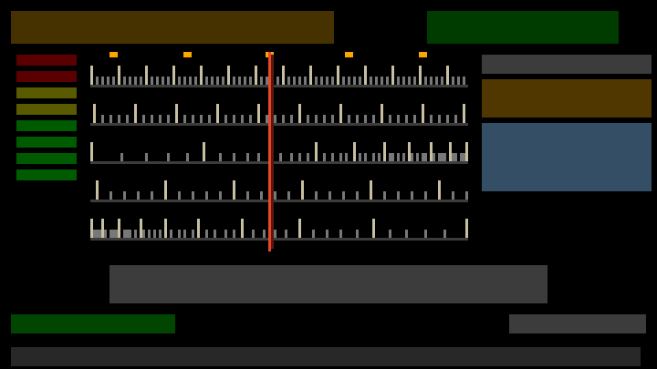
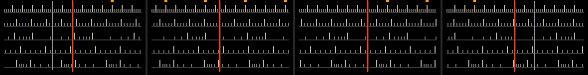
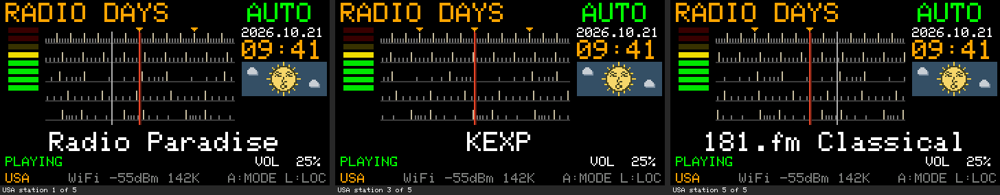
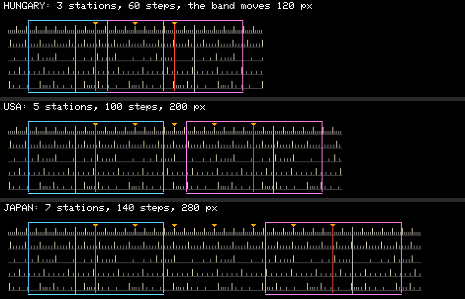
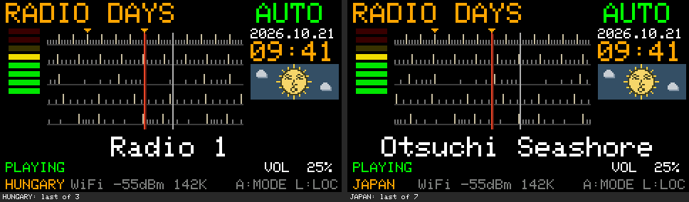
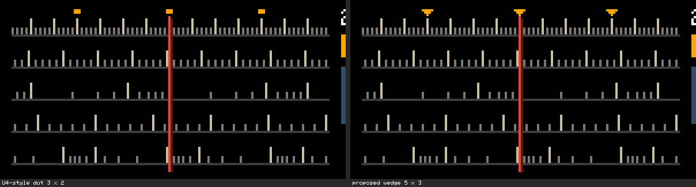
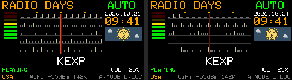

# アナログ風チューニングスケール（案）：U4の周波数表示の置き換え

- 作成日：2026-10-21
- 状態：**調査と設計の提案だけ。U4のファームウェア・試験・記録は変更していない**（容量は、作業用のフォルダにU4を写した試作で測った。リポジトリには入れていない）
- 第2版（同日）：作者の新しい案「**固定指針・可動スケール**」の設計と、第1版（固定目盛り・可動指針）との比較を**第2部**に加えた。**推奨は第2部の案**
- 第3版（同日）：作者が2-A（固定指針・可動スケール・直接描画）を採用。U4の画面配置どおりのプレビューで確認し、**U5の設計を第3部で確定**（実装・ビルドはまだ）
- **状態（最新）：U5実装済み・実機未確認**（2026-10-21）。実装と試験の結果は [usb-u5.md](usb-u5.md)
- 2026-10-22：U5の実機確認の後、U6で目盛りを等間隔・循環式・枠付きに変えた（停止線と対数の段はなくなった）。[usb-u6.md](usb-u6.md)
- 対象：U4（`firmware/RadioDays_U4/RadioDays_U4.ino` の `drawFrequency()`・`drawScale()`）

## 1. 今の周波数表示が占めている領域（U4のラジオの画面、240×135）

| y | 左 | 中央 | 右 |
| --- | --- | --- | --- |
| 2〜17 | 「RADIO DAYS」（大きい文字） | | AUTO／MANUAL（x 156〜） |
| **20〜67** | レベルメーター（x 6〜27、y 20〜65） | **周波数の数字**（Font7、高さ48、`fillRect` x 32〜167）と「MHz」（数字の右、y 58） | 日付・時刻（x 176〜237、y 20〜43）、空の窓（x 176〜237、y 45〜69） |
| **70〜93** | **目盛りの帯（全幅 x 0〜239）**：横線 y 80、目盛り x 14〜226、**数字「80 82 … 90」**、局の印（橙の点 y 71〜73）、赤い針（y 70〜90）と下の三角（〜y 93） | | |
| 96〜111 | 局名（大きい文字、中央） | | |
| 114〜121 | 状態 | | 音量 |
| 126〜133 | Location、Wi-Fi／USB、空きメモリ、キーの案内 | | |

- 描く時：`drawRadio()` の中で、ダイヤルの値（`dialFreq`）が変わったときだけ `drawFrequency()` と `drawScale()` を呼ぶ。どちらも**毎回その領域を塗りつぶして描き直す**（数字は136×48、帯は240×24の塗りつぶし、目盛り約21本、数字6つ、局の印、針）
- ダイヤルの値は仮想の0.1 MHz単位（80.0〜90.0、100段）。音声・USB・Wi-Fiの処理は、この表示を参照しない

## 2. アナログスケールに置き換えられる範囲

- **x 32〜171、y 20〜93**（140×74）：数字・「MHz」・目盛りの帯の中央部分。メーター、時計、空の窓、局名と重ならない
- y 70〜93の左右（x 0〜31、x 172〜239）は、旧い目盛りの帯の端で空く。y 70より上はメーターと時計があるので、**一本の針がすべての段を貫くには、段の幅を x 32〜171 の約140ピクセルにそろえる**のがよい

## 3. 4〜5段の目盛りを配置できるか

**できる。5段の場合**：1段14ピクセル（基線 y 31・45・59・73・87、長い目盛り7ピクセル、短い目盛り3ピクセル）、幅138ピクセル（x 33〜170）。4段なら1段18ピクセルで、長い目盛りを10ピクセルにできる。

目盛りの規則の例（5目盛りごとに長い目盛り。数字・単位・帯域名はなし）：

| 段 | 規則 | 見え方 |
| --- | --- | --- |
| 1 | 2ピクセルごと | 細かい等間隔 |
| 2 | 3ピクセルごと（1ピクセルずらす） | やや粗い等間隔 |
| 3 | 対数（右ほど詰まる） | 昔のAMの目盛りのような不等間隔 |
| 4 | 5ピクセルごと（2ピクセルずらす） | 粗い等間隔 |
| 5 | 逆の対数（左ほど詰まる） | 3段目と向きが逆の不等間隔 |

試作の図（Macで同じ規則で描いたもの。灰色の箱は今の表示の場所の代わり。橙の点は第6節の任意の局の印）：



試作で気づいた点：対数の段は、詰まる側で目盛りがくっついて帯のように見える。**間隔が2ピクセル未満になる目盛りは描かない**（または本数を30本程度に減らす）とよい。

## 4. 一本の指針を左右に動かす方法

| 項目 | 案 |
| --- | --- |
| 位置 | `x = 33 + (dialFreq − 80.0) × 137 ÷ 10.0`（100段を138ピクセルに。1段は約1.4ピクセル）。今の `scaleX()` と同じ計算で、幅だけ変える |
| 形 | 幅2ピクセル：明るい赤橙の線（y 19〜91）と、右に暗い色の線（影）。昔の塗装した金属・樹脂の針の感じ。必要なら上端に小さなつまみ（3×2） |
| 動かし方 | **目盛りは画面に入ったとき（全体の描き直し）に1回だけ描く**。針が動いたら、①旧い針の2列だけを「目盛りの規則から、その列にあるべき点」で描き直し、②新しい位置に針を描く。画面の写し（スプライト、約12〜24 KBのRAM）は使わない |
| 列の描き直し | 「x列の目盛り」は規則から計算できる（等間隔の段は割り算、対数の段は約50個の位置の表で照合）。1列は縦線1本、基線の点5つ、目盛りの縦線0〜5本 |
| ノブ | 操作は今のまま。AUTOは局から局へ針が跳び、MANUALは1目盛り（0.1）で1〜2ピクセル動く。Locationを替えると最初の局の位置へ |
| なめらかさ（任意） | 跳ぶ代わりに、100ミリ秒ごとの画面の更新で数ピクセルずつ寄せる、もできる。描く量は1回あたり同じで小さいが、更新の回数が増えるので、まずは跳ぶ方式を推奨 |

## 5. 描画負荷とファームウェア容量への影響

| 項目 | 今（U4） | 案 |
| --- | --- | --- |
| ダイヤルが動いたとき | 136×48と240×24の塗りつぶし、7セグメントの数字4文字、目盛り約21本、数字6つ、局の印、針 | **2列の描き直しと針（小さな描画が約25回、合計数百ピクセル）** |
| 画面に入ったとき | 上と同じ | 140×74の塗りつぶしと目盛り（約1回分。描き方を工夫すれば数百回の小さな描画） |
| 更新の頻度 | `drawRadio()`（100ミリ秒ごと、値が変わったときだけ） | 同じ |
| 音声への影響 | 描画は `loop()`（コア1）、デコードは別のタスク（コア0） | 同じ構成で、描く量は減る。**新しい待ち・タスク・計算の繰り返しはない** |
| フラッシュ | 1,374,080 B（残り2,176 B） | **試作で1,374,192 B（+112 B、残り2,064 B）** |
| RAM | ― | 約100 B（対数の段の位置の表）。表をプログラムの中の定数にすれば、RAMは0でフラッシュが約100 B |

- 7セグメントの字体（Font7）を使わなくなっても、**フラッシュは減らなかった**（試作で確認。字体の一覧から参照されているためと考えられる【推測】）
- 試作は、目盛りの位置の計算に浮動小数の対数を使った。定数の表にすれば、さらに数十バイト減る見込み

## 6. 既存の表示を維持できる推奨レイアウト

```text
y  2  RADIO DAYS                         AUTO
y 20  [メーター]  ┃┃┃┃┃┃┃┃┃┃┃┃┃┃┃┃┃┃┃┃┃┃┃┃  2026.10.21
      [ x6〜27 ]  ┃  5段の目盛り  │針    ┃  09 41
      [ y20〜65]  ┃  x 33〜170      │      ┃  [空の窓]
y 70              ┃  y 20〜90       │      ┃  [y45〜69]
y 90              ┃┃┃┃┃┃┃┃┃┃┃┃┃┃┃┃┃┃┃┃┃┃┃┃
y 96            （局名）
y114  PLAYING                          VOL 50%
y126  NZ  WiFi -55dBm 120K        A:MODE L:LOC
```

| 維持するもの | 扱い |
| --- | --- |
| 局名、状態、音量、最下行 | 変えない（y 96〜） |
| Locationと地球儀（Location画面） | 変えない |
| 時計、空、太陽、月 | 変えない（x 176〜） |
| レベルメーター | 変えない（x 6〜27） |
| AUTO／MANUAL、ノブ、キー | 変えない |
| USB・Wi-Fiの再生 | 変えない（表示だけの変更） |

**作者に決めていただきたいこと**

1. **段の数**：5段（各14ピクセル）か、4段（各18ピクセル、目盛りが長い）か
2. **局の印**：数字ではない小さな橙の点を、いちばん上の段の上に残すか（AUTO／MANUALで局の位置がわかる。図は残した場合）。残さなければ、目盛りは完全に「意味のわからない」ものになる
3. **目盛りの色**：長い目盛りをクリーム色、短い目盛りを灰色（図）にするか、昔の文字盤の照明のような色にするか
4. **空く場所**：旧い目盛りの帯の左右（y 70〜93、x 0〜31・172〜239）は黒のまま。目盛り全体を細い枠（窓）で囲むこともできる（数十バイト）
5. **版の名前**：U4の実機確認の後に、別の版（例：U5）として作るか

## 7. 実装するときの注意

- U4の試験（`tools/u4-test` など）は周波数表示に触れていないので、そのまま使える。目盛りの列の描き直しが「針を除いた状態」と一致することを、Macの試験で確かめる（全体を描いた画面と、針を何回も動かした後の画面を比べる）
- 数字の表示に使っていた行（`drawFrequency`・`drawScale`・`scaleX`）は消し、`drawRadio()` の2行を置き換えるだけにする


---

# 第2部：固定指針・可動スケール（作者の新しい案）と比較

## 8. 方式の概要

- 指針は目盛りの窓の中央（x 101〜102）に**固定**し、画面に入ったときに1回だけ描く
- 5段の目盛りは一体の「長い帯」で、ノブを回すと帯が左右に動き、指針の下の位置が変わる
- 目盛りの模様と各段の尺度は**全Locationで共通**。Locationの局数で変わるのは、**帯の動ける長さ（両端の位置）だけ**
- 数字、単位、帯域名は入れない（第1部と同じ）

## 9. 目盛りの模様（全Locationで共通）

帯の上の位置を `u`（ピクセル）とし、各段は `u` だけで決まる（ランダムではない。どの段も5目盛りごと、または区切りごとに長い目盛り）。

| 段 | 規則 | 見え方 |
| --- | --- | --- |
| 1 | 2ピクセルごと、5本ごとに長い | 細かい等間隔 |
| 2 | 3ピクセルごと（1ずらす）、5本ごとに長い | やや粗い等間隔 |
| 3 | 60ピクセルを1区切りに、`60×log10(k)`（k＝1〜9）の位置。k＝1と5が長い | 計算尺のような、右へ詰まる不等間隔のくり返し |
| 4 | 5ピクセルごと（2ずらす）、5本ごとに長い | 粗い等間隔 |
| 5 | 45ピクセルを1区切りに、3段目を縮めて左右を逆にしたもの | 左へ詰まる不等間隔のくり返し |

- 周期が2・3・60・5・45ピクセルと異なるので、帯を動かしても同じ絵がすぐには繰り返さない
- 対数の位置は**整数の表（9個）**にした（第1部の試作の浮動小数の計算はやめる。容量が減る。第12節）
- 帯は、動ける範囲の両端からさらに窓の半分（約70ピクセル）先まで模様を続ける。窓はいつも目盛りで埋まる
- 動ける範囲の**両端に「止まり」の線**（全段を貫く少し明るい縦線）を描く。昔のダイヤルの端のように、そこで帯が止まる

試作の図（左から：5局のLocationの1局目、5局の3局目と4局目の間（MANUAL）、3局のLocationの下端、3局の最後の局。橙の点は局の印、灰色の縦線は「止まり」）：



## 10. 局数に応じた移動範囲と停止位置（具体案）

### 10.1 決まり

| 項目 | 値 | 意味 |
| --- | --- | --- |
| 1段（MANUALの1目盛り） | 帯が**2ピクセル**動く | 全Locationで同じ。今の針の動き（約2.1ピクセル）とほぼ同じ手ごたえ |
| 局と局の間 | **20段**（40ピクセル） | 全Locationで同じ。MANUALでは局の間に19段の雑音（今とほぼ同じ） |
| 端の余白 | **10段**（20ピクセル） | 最初の局の手前と、最後の局の先 |
| 動ける範囲 | `10 + (局数−1)×20 + 10` 段 | 局数だけで決まる |

| 局数 | Locationの例 | 動ける範囲 | 帯の移動 | 局の位置（段） |
| --- | --- | --- | --- | --- |
| 3 | HUNGARY、THAI、AUSSIE、CANADA | 60段 | 120ピクセル | 10、30、50 |
| 4 | SWEDEN、ITALY、TAIWAN、BRAZIL | 80段 | 160ピクセル | 10、30、50、70 |
| 5 | USA、UK、FRANCE、WORLD、ほか | **100段**（今と同じ） | 200ピクセル | 10、30、50、70、90 |
| 7 | JAPAN | 140段 | 280ピクセル | 10、30、…、130 |

**3局の国は短く、7局の国は長く回る。どの国でも、1目盛りの手ごたえ、局と局の間の距離、目盛りの模様は同じ**（作者の希望どおり、尺度は伸び縮みしない）。

### 10.2 実装のしかた：選局の処理は変えず、`stations.h` の数字だけを並べ直す

- 選局の処理（`stationAtFreq()`・`nextStationFreq()`・`nearestStationFreq()`・`tuneBy()`）は、Locationごとの範囲（`freqMin`〜`freqMax`）と各局の値（`freq`）だけを使っている。**この値を10.1節の決まりで並べ直せば、選局のコードは1行も変えなくてよい**
  - 例：5局 → 範囲 800〜900、局 810・830・850・870・890。3局 → 範囲 800〜860、局 810・830・850。JAPAN（7局）→ 範囲 800〜940、局 810〜930
- 数字を表示しなくなるので、この値は画面に出ない「ダイヤル上の位置」になる。今の値（例：Radio Paradiseの80.2をStage 2-3から保つ、など）の意味はなくなる（**作者の確認事項**）
- ビルド時の検査（`static_assert`）を「局はfreqMin＋10から20ごと、範囲は局数で決まる」に替え、並べ直しの誤りを防ぐ
- 帯の位置は `(dialFreq − freqMin) × 2` ピクセル。Locationを替えると、今と同じく最初の局（帯は左端から20ピクセル）から始まる
- 保存したLocation（名前で照合）、局名、局の順番は変わらない

### 10.3 AUTO／MANUALとの対応

| 操作 | 今（U4） | 可動スケール |
| --- | --- | --- |
| AUTO：ノブ1目盛り | 次の局へ（端で一周） | 同じ。帯が40ピクセル跳ぶ。最後の局から最初の局へ一周するときは、帯が逆向きに大きく戻る（1回の描き直し） |
| MANUAL：ノブ1目盛り | 0.1（1段）、雑音、端で止まる | 同じ。帯が2ピクセル動く。端の「止まり」の線が指針に来たところで止まる |
| MANUAL：速く回す | 100ミリ秒の間の目盛りがまとまって1回の描き直し | 同じ（描き直しは最新の位置だけ） |
| 局に合う | 局名が出る、350ミリ秒止まると受信 | 同じ。**局の印（橙の点）が指針の真上に来る** |
| A（モード切替）、押す（ミュート）、押して回す（音量） | 変えない | 変えない |

局の印について：数字がないので、MANUALで局を探すには印があるとよい（帯と一緒に動き、近づいてくるのが見える）。**印を付けることを推奨**（作者の確認事項。付けない場合も実装の手間は同じ）。指針が印を隠さないよう、指針の上端を印の行より下から始める。

### 10.4 なめらかに動かすか

- 推奨：**跳ぶ**（AUTOの40ピクセルも1回の描き直し）。今の100ミリ秒の更新の中で、値が変わったときだけ描く
- 任意：AUTOの跳びだけを、今の100ミリ秒の更新に乗せて2〜3回に分けて寄せる（新しいタスクや短い周期の更新は使わない）。描き直しの回数が2〜3倍になるので、まずは実機で「跳ぶ」を見てから判断する

## 11. 描き方（音声を最優先）

| 案 | しくみ | 1回の選局の描画 | RAM |
| --- | --- | --- | --- |
| **2-A 差分を直接描く（推奨）** | 帯の前の位置と新しい位置を、窓の列ごと・段ごとに比べ、**目盛りが変わった列だけ**、古い目盛りを消して新しい目盛りを描く。全体の塗りつぶしはしない。指針の2列には触れない | 小さな縦線の描画 **約200〜290回、最大約1,600ピクセル**（Macで規則を同じにして数えた：MANUAL 1目盛りで約280回、AUTOで約200回） | 増えない（数十バイト） |
| 2-B 画面の写し（2ビット色のキャンバス） | 138×70のキャンバスに描き、指針の列を除いて2回に分けて送る | 約9,500ピクセルを送る | **約2.4 KB**（ラジオの画面の間だけ確保。空きヒープは約142 KB：U2a3の記録） |
| （不採用）表示器の画面の巻き取り | 画面の向きの関係で、巻き取れるのは横の範囲全体（見出しや局名の行も一緒に動く） | ― | ― |

2-Aは、1本ずつ消して描くので、目盛りが一瞬ちらつく可能性がある（1本あたり数マイクロ秒【推測】。実機で確認）。気になる場合は2-Bに切り替える（容量の差は約500 B）。

## 12. 比較

容量は、U4（1,374,080 B）を作業用のフォルダに写し、3つの方式を**同じ整数の目盛りの規則**で試作してビルドした実測。描画の量は、コードと規則から数えたもの（時間は【推測】：表示器への送信を約40 MHz、1ピクセル16ビットとして）。

| 項目 | U4の今（数字＋目盛り） | 1. 固定目盛り・可動指針 | **2-A 固定指針・可動スケール（直接）** | 2-B 同（キャンバス） |
| --- | --- | --- | --- | --- |
| 1回の選局の描画 | 136×48と240×24の塗りつぶし、7セグメントの数字、目盛り約21本、数字6つ、針：**約18,000ピクセル**（約7ミリ秒【推測】） | 2列の描き直しと針：**約25回、約300ピクセル**（0.1ミリ秒程度） | **約200〜290回、最大約1,600ピクセル**（1〜2ミリ秒程度【推測】） | 約9,500ピクセル（約4ミリ秒【推測】）＋RAMの中の描画 |
| 画面に入ったとき | 同上 | 約140列（約1,500回の小さな描画） | 塗りつぶし1回＋目盛り約200本 | 同じく9,500ピクセル |
| フラッシュ（実測） | 1,374,080 B | 1,373,312 B（**−768 B**） | 1,373,344 B（**−736 B**） | 1,373,840 B（−240 B） |
| 静的RAM（実測） | 59,740 B | 59,756 B（+16） | 59,756 B（+16） | 59,764 B（+24）＋ヒープ約2.4 KB |
| 100ミリ秒の更新との相性 | 値が変わったときだけ描く | 同じ | 同じ（速く回しても100ミリ秒に1回、最新の位置だけ） | 同じ |
| 音声への影響 | 描画は `loop()`（コア1）、デコードは別のタスク（コア0）。実機で安定（U2a2〜U3） | 今より大幅に軽い | **今より軽い**（描くピクセルは今の1/10以下）。新しいタスク・待ち・短い周期の更新なし | 今より軽い。ヒープを2.4 KB使う |
| AUTOの操作感 | 数字と針が跳ぶ | 針が跳ぶ | 帯が跳ぶ（局の印が指針に来る） | 同左 |
| MANUALの操作感 | 1目盛りで針が約2.1ピクセル | 1目盛りで約1.4ピクセル（窓が狭いため細かくなる） | **1目盛りで帯が2ピクセル**（全Location同じ） | 同左 |
| 局数の違いの表現 | なし（全Location 100段） | 難しい：範囲を縮めると「目盛りの一部しか使わない」か「尺度が伸びる」 | **自然**：動ける長さだけが変わる | 同左 |
| ちらつき | 数字の描き直しで一瞬消える | ほぼなし | 目盛りの1本ずつの描き直し（小さい） | なし |

- 第1部の試作の「+112 B」は、対数の位置を浮動小数で計算していたため。整数の表にすると、どの方式も**U4より約0.2〜0.8 KB小さくなる**（7セグメントの数字の処理、目盛りの数字の文字列、三角形の描画がなくなるため）
- 1回の選局の描画は、方式1が最も少ないが、方式2-Aでも**今のU4（実機で安定を確認済み）より大幅に少ない**

## 13. 推奨案

**2-A：固定指針・可動スケール、差分を直接描く方式。**

1. 局数による違いを、尺度を変えずに「動ける長さ」で表せる（作者の目的）
2. 描画は今のU4より少なく、新しいタスク・待ち・短い周期の更新を加えない。描くのは今と同じく `drawRadio()`（100ミリ秒ごと、値が変わったときだけ）
3. 容量は今より約0.7 KB減る見込み（試作の実測）。RAMはほぼ増えない
4. 選局のコード（AUTO／MANUAL、雑音、受信の開始）は変えず、`stations.h` の位置の値を並べ直すだけ
5. 実機でちらつきが気になれば、2-B（キャンバス、ヒープ2.4 KB）に切り替えられる

**作者に決めていただきたいこと**

1. 局の位置の値（10.1節：局の間20段、端の余白10段、1段2ピクセル）でよいか。今の値（Radio Paradise 80.2 など）は使わなくなる
2. 局の印（橙の点）を付けるか（推奨：付ける）
3. AUTOの跳びを、今の更新周期のまま2〜3回に分けて寄せるか（推奨：まずは跳ぶ）
4. 両端の「止まり」の線を描くか（推奨：描く）
5. 版の名前（例：U5。U4の実機確認の後）

## 14. 実装するときの試験の案

- Macの試験：表示器の代わりに画素の配列を置き、「帯を任意の順で動かした後の画面」が「その位置で全体を描いた画面」と1画素も違わないこと（差分の描き方の確認）。指針の2列に一度も描かないこと
- `stations.h` の並べ直しをビルド時に検査（10.2節）
- U4のホスト試験・sim4・時刻の試験は、選局と再生の処理を変えないのでそのまま使う
- 実機：AUTO／MANUAL、3局・5局・7局のLocationでの端の止まり、速く回したとき、再生中に回したときの音切れの有無


---

# 第3部：U5の設計の確定（作者の決定とプレビューの確認）

## 15. 作者の決定（2026-10-21）

| # | 項目 | 決定 |
| --- | --- | --- |
| ① | 局の位置 | 局の間20段、両端の余白10段、MANUALの1段で帯が2ピクセル |
| ② | 局の印 | 付ける（小さな橙色） |
| ③ | AUTOの移動 | 1回で次の局へ。動きの演出は加えない |
| ④ | 両端の止まり | 描く |
| ⑤ | 版の名前 | **U5**。U4は変更せず保存 |

方式：**2-A（固定指針・可動スケール、差分を直接描く）**。新しいタスク・待ち・短い周期の更新は加えず、今の100ミリ秒の `drawRadio()` の中で、ダイヤルの値が変わったときだけ描く。

## 16. プレビュー（U4の画面配置どおりに描き直したもの）

第2部の図（`analog-dial-moving-scale.png`）は目盛りの部分だけで、画面の他の部分と、局の印の位置（指針の上端と重なる）が実際と違っていた。そこで、**240×135の画面全体を、U4のコードの位置・色・文字（本体の6×8の字体 `glcdfont.h`）で描く**生成のスクリプトを作った。

```bash
python3 tools/dial-preview/make_dial_preview.py ~/Documents/Arduino/libraries/M5GFX/src/lgfx/Fonts/glcdfont.h docs/images
```

- レベルメーター、日付・時刻、昼の空（雲と太陽の顔）、局名、状態、音量、最下行は、U4の描画の処理を写したもの。音の大きさ・時刻・電波の強さは例
- 図は2倍（`analog-dial-u5-marks.png` は4倍、`analog-dial-u5-marks-actual.png` は等倍）

### 同じLocationで3局（USA、5局の1・3・5局目）



指針（x 101）は動かず、背後の5段の目盛りと局の印が左へ送られている。1局目では左に「止まり」の線が見え、5局目では右に見える。

### 局数の違う国の移動範囲（3局・5局・7局）



帯全体（窓に出る可能性のあるすべて）。水色の枠は最初の局、桃色の枠は最後の局のときに画面に出る部分、赤い線はそのときの指針。**目盛りの模様と間隔はどの国も同じで、帯の長さ（止まりの線の間）だけが違う。**

### 最後の局（HUNGARY 3局目、JAPAN 7局目）



## 17. 確認の結果（5項目）

| # | 項目 | 結果 | 確定する内容 |
| --- | --- | --- | --- |
| 1 | 5段の密度とバランス | 1段目（2ピクセルごと）が細かい地模様、2・4段目が中くらい、3・5段目（対数のくり返し）がまばら。段ごとの性格の違いがはっきりし、何の目盛りかはわからない。数字はない | 第9節の規則のまま。1段14ピクセル、基線 y 31・45・59・73・87 |
| 2 | 固定指針の見やすさ | 赤橙の1ピクセルと暗い影の1ピクセルで、5段すべてを貫いて目立つ。灰色・クリーム色の目盛りと色が重ならない | x 101（明）・102（影）、y 23〜90 |
| 3 | 局の印 | **3×2の点は等倍で小さい**（1ピクセルは約0.1 mm）。指針の上端と同じ高さに置くと隠れる | **5×3の下向きのくさび**（y 20〜22）に変更。指針は y 23から始め、局に合うと**くさびの先が指針の真上**に来る（拡大図・等倍図） |
| 4 | 両端の止まり | 全段を貫く明るい灰色の線で、長い目盛り（クリーム色）より高く、区別できる。止まりの外も模様は続く（窓が常に埋まる） | y 23〜90、色 (175,175,175) |
| 5 | 既存の表示とのバランス | メーター（x 6〜27）と目盛り（x 33〜）の間5ピクセル、目盛り（〜x 170）と時計・空（x 176〜）の間5ピクセルで、左右がそろう。局名（y 96〜）との間も6ピクセルある | 第6節のレイアウトのまま |

局の印の比較（左：3×2の点、右：5×3のくさび。4倍）：



等倍（実際の画面の大きさ）：



### 確認で見つかった、U4の最下行の重なり（目盛りとは別）

7文字のLocation（GERMANY、HOLLAND、CZECHIA、HUNGARY）では、最下行のLocationの名前（x 4〜45）の直後に「WiFi …」（x 46〜）が続き、**すき間がなく読みにくい**（上の HUNGARY の図。U4の配置そのものの問題で、U4で7文字の国を加えたときに生じた）。U5で、「WiFi …」の書き出しを x 46 → **x 50** に移すことを提案する（数バイト。上の図は修正後の位置）。**作者の確認事項。**

## 18. U5の設計（確定案）

### 18.1 画面（ラジオの画面だけ）

| 部分 | 位置 | 内容 |
| --- | --- | --- |
| 目盛りの窓 | x 33〜170（138ピクセル）、y 20〜90 | 下の5段、局の印、止まり、指針。**数字・単位・帯域名なし** |
| 5段 | 基線 y 31・45・59・73・87（色 (60,60,60)） | 短い目盛り3ピクセル（灰 (120,120,120)）、長い目盛り7ピクセル（クリーム (200,190,160)） |
| 局の印 | y 20〜22、5×3の下向きのくさび、橙（`COL_AMBER`） | 帯と一緒に動く |
| 止まり | 動ける範囲の両端、y 23〜90、(175,175,175) | 帯と一緒に動く |
| 指針 | x 101・102、y 23〜90、(235,70,40)と(90,25,15) | **固定**。描き直さない |
| そのほか | U4のまま | メーター、時計、空・太陽・月、局名、状態、音量、最下行（「WiFi …」をx 50へ：要確認）、AUTO／MANUAL |

消すもの：7セグメントの周波数、「MHz」、数字入りの目盛りの帯（`drawFrequency()`・`drawScale()`・`scaleX()`）。

### 18.2 目盛りの帯と局の位置

| 項目 | 値 |
| --- | --- |
| 帯の位置 | `(dialFreq − freqMin) × 2` ピクセル。窓の列 x に出るのは、帯の座標 `u = 80 + 帯の位置 + (x − 101)` |
| 各段の規則 | 第9節（整数の表。浮動小数を使わない） |
| 局の位置 | freqMin＋10、＋30、＋50 …（20段ごと） |
| 範囲 | freqMax ＝ freqMin ＋ 20 ＋ (局数−1)×20 |
| `stations.h` | 各局の `freq` と各Locationの `freqMax` を上の決まりで並べ直す（局名、URL、順番、Locationの名前と順番は変えない。保存したLocationの互換性はそのまま）。ビルド時の検査を「局は10から20ごと、範囲は局数で決まる」に替える |

| 局数 | Location | 範囲（段） | 帯の移動 |
| --- | --- | --- | --- |
| 3 | HUNGARY、THAI、AUSSIE、CANADA | 60 | 120ピクセル |
| 4 | SWEDEN、ITALY、TAIWAN、BRAZIL | 80 | 160ピクセル |
| 5 | USA、UK、FRANCE、WORLD、GERMANY、HOLLAND、POLAND、CZECHIA、NZ、ARGENT | 100 | 200ピクセル |
| 7 | JAPAN | 140 | 280ピクセル |

### 18.3 描き方（2-A）

1. **画面に入ったとき**：窓を1回塗りつぶし、5本の基線、その位置の目盛り・局の印・止まり、指針を描く
2. **ダイヤルの値が変わったとき**（`drawRadio()`、100ミリ秒ごとに見る。速く回しても最新の位置を1回だけ）：窓の各列・各段で、前の位置と新しい位置の目盛りを比べ、**違う列だけ**、古い目盛りを背景色で消して新しい目盛りを描く。局の印と止まりも同じく比べて描く。**指針の2列には描かない**
3. 新しいタスク、待ち、短い周期の更新、画面の写し（キャンバス）は使わない
4. 量：1回あたり小さな縦線の描画が約200〜290回、最大約1,600ピクセル（今のU4の数字と目盛りの描き直し、約18,000ピクセルの1/10以下）

### 18.4 選局（変えない）

AUTO（1目盛りで次の局、端で一周）、MANUAL（1段、雑音、端で止まる）、350ミリ秒止まると受信、Aでモード切替、押す・押して回すは、U4のコードのまま。変わるのは `stations.h` の位置の値と、目盛りの描画だけ。USB・Wi-Fiの再生、リンク、中継は変えない（U5の中継はU4のものをそのまま使う）。

### 18.5 容量の見込み

| 項目 | 見込み |
| --- | --- |
| フラッシュ | U4（1,374,080 B）より**約0.6〜0.7 KB小さい**（試作2-Aの実測は−736 B。くさびの印と止まりの分を足して、数十〜百バイト増える【推測】）。実装後に実測する |
| 静的RAM | 約+16 B（試作の実測） |
| ヒープ | 増えない |

### 18.6 試験の計画（実装のとき）

| 試験 | 内容 |
| --- | --- |
| 目盛りの差分（新規、Mac） | 画素の配列を表示器の代わりにし、帯を任意の順（1段ずつ、速く、AUTOの跳び、一周、端での止まり、Locationの切り替え）で動かした後の画面が、その位置で全体を描いた画面と1画素も違わないこと。指針の2列に一度も描かないこと。1回の描画の回数と画素数の最大 |
| `stations.h` | ビルド時の検査（局の間隔と範囲）。85局、19のLocation、名前と順番がU4と同じこと |
| 回帰 | U4のホスト試験（Wi-Fi、NVS、Location、案内）、sim4、時刻の試験、人工衛星の試験（変えていないことの確認） |
| 容量 | 0x150000以内、自分のコードの警告0件 |
| 実機（作者） | AUTO／MANUAL、3局・5局・7局での止まり、速く回したとき、再生中に回したときの音切れの有無、目盛りのちらつき |

## 19. 作者に確認していただきたいこと（実装の前に）

1. 局の印を**5×3の下向きのくさび**にしてよいか（3×2の点は等倍で小さい）
2. 最下行の「WiFi …」を x 50 に移して、7文字のLocationとのすき間を作ってよいか（U5に含める）
3. 18.1〜18.4の内容でU5を実装してよいか
