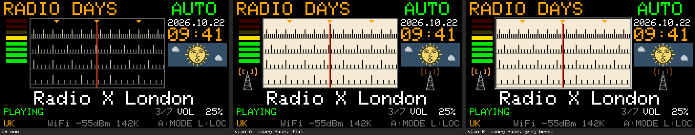
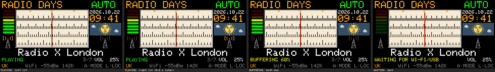
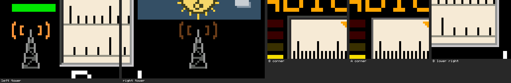
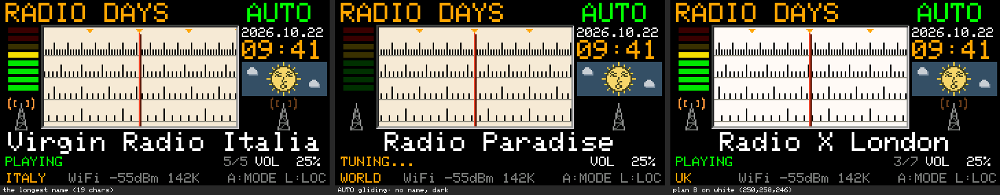
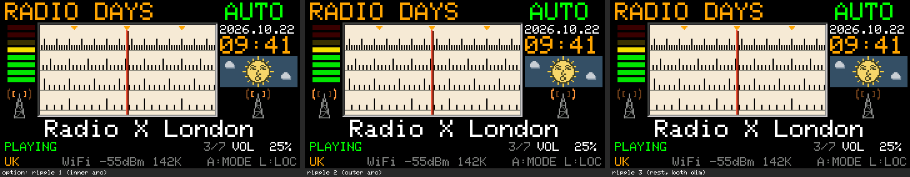
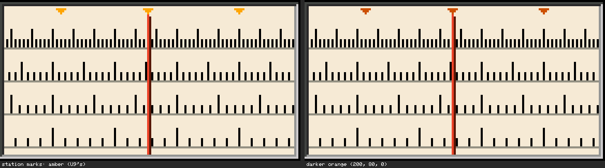

# 白い文字盤のチューニングメーターと電波塔：調査とプレビュー

- 作成日：2026-10-22
- 状態：**第1段階（現状調査）と第2段階（実寸のプレビュー）まで**。ファームウェアは変えていない（U3〜U9、`stations.h`、中継、README、CHANGELOGはそのまま）。実装は作者がプレビューを確認してから
- 調べた版：U9（`firmware/RadioDays_U9/RadioDays_U9.ino`）
- **2026-10-22 追記：作者がB案を採用し、U10として実装した** → [usb-u10.md](usb-u10.md)（局の印は濃いオレンジ、ミュート中はPLAYINGと同じ、BUFFERING・CONNECTINGは両方を弱く、点滅800ミリ秒）
- プレビュー：`tools/u10-preview/make_face_tower_preview_u10.py`（U9の `drawDial()` と同じ目盛り・枠・印・指針を、色だけ替えて描く。ほかの部分はU9の配置・色・本体の6×8の字体。色はRGB565に丸めた値）。**Macで描いた見本で、実機の画素ではない**

## 1. 現状調査（U9のコード）

### 1.1 チューニングメーター（`drawDial()`、`RadioDays_U9.ino`）

| 部分 | 座標 | 今の色 |
| --- | --- | --- |
| 枠（1ピクセル） | x 31〜172、y 19〜92（`drawRect`） | 灰 (96,96,96) |
| 内側（目盛りの面） | x 32〜171、y 20〜91 | 黒（`COL_BG`） |
| 目盛りの段 | **4段**（U6から。基線 y 40・56・72・88、間隔2・3・4・6ピクセル、5本ごとに長い目盛り） | 基線 (60,60,60)、短い目盛り (120,120,120)、長い目盛り (200,190,160) |
| 局の印（下向きのくさび） | y 21〜23 | 琥珀色（`COL_AMBER`） |
| 指針 | x 101（明）・102（影）、y 24〜91 | (235,70,40)・(90,25,15) |

- ご依頼の文の「5段」は、U5の5段のことと思われます。**U6以降（U9も）は4段**です。プレビューも4段で描きました（段数・間隔・動きは変えない）
- 描き方：全体を描くのは画面の全体の描き直しのときだけ。ダイヤルが動いたときは、目盛りが変わった列だけを描き直す。このとき**消す色に `COL_BG`（黒）を使っている**（内側の塗りつぶし、目盛りを短くするときの消し、局の印の消し）。白い文字盤にするには、この3か所の消す色を文字盤の色に替える必要がある（第4節）
- 左の赤・黄・緑のレベルメーター（x 6〜27、y 20〜65、`drawMeter()`）は別の処理で、今回は触らない

### 1.2 空いている場所（ラジオ画面、y 0〜134）

| 領域 | 座標 | 今の表示 |
| --- | --- | --- |
| 上の行 | y 2〜17 | 「RADIO DAYS」（x 4〜123）、「AUTO／MANUAL」（x 156〜239） |
| 左の列 | x 6〜27、y 20〜65 | レベルメーター |
| 右の列 | x 176〜237 | 日付 y 20〜27、時計 y 29〜44、空の窓（太陽・月・雲・星）y 45〜69 |
| 局名 | y 96〜111（大きい字、19文字で x 6〜233） | 局名、または中継の案内 |
| 状態の行 | y 114〜121 | 状態の文字、`n/N`、音量 |
| 下の行 | y 126〜133 | Location、Wi-Fi、ヒント |
| **左の空白** | **x 0〜29、y 66〜95**（30×30） | なし（レベルメーターの下、ダイヤルの左、局名の上） |
| **右の空白** | **x 174〜239、y 70〜95**（66×26） | なし（空の窓の下、ダイヤルの右、局名の上） |
| ダイヤルの真下 | y 93〜95 | なし（**3ピクセルしかない**） |

**位置についての確認**：ご依頼の左の電波塔の位置「チューニングメーターの下、局名の上」について、ダイヤル（チューニングメーター）の真下は局名まで3ピクセルしかなく、塔は置けません。実機で左に見える空白は、**レベルメーターの下（ダイヤルの左）**の x 0〜29、y 66〜95 です。プレビューではここに置きました（右は空の窓の下）。どちらも局名より上で、局名の左右ではありません。

### 1.3 容量

| 項目 | 値 |
| --- | --- |
| U9のアプリ | 1,370,640 B（実測） |
| 0x150000までの残り | **5,616 B**（実測） |
| 今回の変更の見込み | 色の定数の変更：ほぼ0。縁取り（線4本）：約0.1 KB。電波塔と電波：点の座標の小さな表（塔約60点、電波約60点を左右で共有、1点2バイト）と描く処理で **約0.5〜1 KB**【推測。ビルドして測るまで確定しない】 |

### 1.4 既存の機能への影響

| 箇所 | 影響 |
| --- | --- |
| `drawDial()` | 色だけ（内側の塗り、消す色、目盛り・基線の色、枠）。目盛りの位置・長さ・間隔・動き・局の印の位置・指針は変えない |
| `drawRadio()` | 全体の描き直しで縁取りと塔を描く。100ミリ秒ごとの処理で、電波の点灯の状態が変わったときだけ電波の点（約60点）を描き直す |
| 選局・AUTO・MANUAL・音声・ネットワーク・USB・NVS・時計・空・音量・`n/N` | 変えない（読むだけ。状態の表示と同じ値を使う） |
| 試験 | U6からのダイヤルの画素の試験・プレビューとの比較は黒い背景を前提にしているので、新しい版用に色を替えた試験が要る |

## 2. プレビュー（240×135、2倍に拡大）

### 2.1 A案とB案

左からU9の今、A案（アイボリーの文字盤、平面）、B案（アイボリーの文字盤＋灰色の縁取り、くぼんだ窓）。

| 色（RGB、RGB565に丸める） | A案 | B案 |
| --- | --- | --- |
| 文字盤 | アイボリー (240,234,214) | 同じ |
| 目盛り（長い・短い） | 黒 (0,0,0) | 同じ |
| 基線（各段の横線。U9からある線） | 温かい灰 (150,145,132) | 同じ |
| 枠 | U9の1ピクセルの灰 (96,96,96) | 2ピクセルの縁取り（下の表） |
| 局の印 | 琥珀色（U9のまま） | 同じ |
| 指針 | U9のまま | 同じ |

B案の縁取り（文字盤の外周だけ。内側に新しい線は描かない）：

| 線 | 位置 | 上辺・左辺（暗い） | 下辺・右辺（明るい） |
| --- | --- | --- | --- |
| 外側（新しい線） | x 30〜173、y 18〜93 | (70,70,70) | (200,200,200) |
| 内側（U9の枠の線の位置） | x 31〜172、y 19〜92 | (40,40,40) | (150,150,150) |

外側の線の位置（x 30・173、y 18・93）は、今のU9では何も描いていない列・行（第3節の確認）。

### 2.2 電波の点灯（B案）

左から、PLAYING（左が点灯）、PLAYING（0.8秒後、右が点灯）、BUFFERING（両方を弱く）、WAITING（消灯）。

### 2.3 拡大（6倍）

左の塔、右の塔、B案の左上の角、A案の左上の角、B案の右下の角。

- 塔：高さ20ピクセル（先端 y 75、足もと y 94）、足もとの幅9ピクセル。細いマスト、2本の脚、3つの横材、ジグザグの筋かい。色は落ち着いた灰（150,150,145）と暗い灰（95,95,92）。左右同じ形
- 電波：先端の左右に2本ずつの細い弧（半径5と9、水平から上下30°）。点灯 (255,150,60)、弱い (110,62,28)
- 位置：左の塔 x 6〜24、y 71〜94。右の塔 x 197〜215、y 71〜94（空の窓の中央 x 206 の下）

### 2.4 確認の場面

いちばん長い局名（19文字の「Virgin Radio Italia」、x 6〜233）、AUTOの移動中（局名なし、TUNING...、電波は消灯）、白い文字盤 (250,250,246) のB案。

### 2.5 そのほかの案

**別案：さざ波**（内側の弧 → 外側の弧 → 休み、の順に点灯）。左右は同時。1つの塔の中で電波が外へ広がって見える。点の数は左右交互と同じ程度。

**局の印の色**：琥珀色（U9のまま）はアイボリーの上で少し薄く見える。濃いオレンジ (200,80,0) の案も並べた（指針の色は変えない）。

## 3. 重なりの確認（プレビューのスクリプトで自動）

新しく描く点（B案の外側の線、2つの塔、すべての電波の点）が、U9が描くもの（RADIO DAYS、AUTO／MANUAL、レベルメーター、日付、時計、空の窓、ダイヤルの枠の中、19文字の局名の行の全幅、状態・`n/N`・音量の行の全幅、下の行の全幅）と**1点も重ならない**ことを確かめた。

- 左の塔と電波：x 6〜24、y 71〜94（レベルメーターの下端 y 65 から5ピクセル、局名 y 96 の2ピクセル上、縁取り x 30 から5ピクセル）
- 右の塔と電波：x 197〜215、y 71〜94（空の窓の下端 y 69 から1ピクセル）
- B案の外側の線：x 30〜173、y 18〜93（上の行の文字の下端 y 17、局名の上端 y 96、時計の左端 x 176、レベルメーターの右端 x 27 のどれにも触れない）

## 4. 実装の設計（案。実装は確認の後）

### 4.1 チューニングメーター
- 色の定数（文字盤、目盛り、基線、縁取り）を加え、`drawDial()` の内側の塗り・目盛りの消し・局の印の消しを `COL_BG` から文字盤の色に替える。目盛りの位置・長さ・間隔、局の印の位置、指針、変わった列だけ描く方式は変えない
- B案の縁取りは、全体を描くときに4本の線（外側）＋U9の枠の位置の4本の線（内側、色だけ2色に）。目盛りの描き直しでは触れない

### 4.2 電波塔と電波
- 塔は全体の描き直しのときだけ描く（点の小さな表から）
- 電波は `drawRadio()`（100ミリ秒ごと、ラジオ画面のときだけ）で、**状態の行と同じ値**（`shown`：PLAYING、BUFFERING、TUNING...、NO STATION、WAITING…）から決める：

| 状態の表示 | 電波 |
| --- | --- |
| PLAYING | 左右交互に点灯（0.8秒ずつ） |
| BUFFERING、CONNECTING | 両方を弱く（点滅しない） |
| WAITING FOR WI-FI/USB、USB RELAY REQUIRED、TUNING...（移動中・待ち）、NO STATION（局の間）、STOPPED、NO SIGNAL、UNAVAILABLE、NOT ENOUGH MEMORY | 消灯 |

- 点灯の状態（「左」「右」「弱い」「消灯」）が前と同じなら何も描かない。変わったときだけ、電波の点（片側約30点）をその色または背景の色で描き直す。`delay()`、新しいタスク、画面全体の描き直し、画面外のキャンバスは使わない
- 時刻は `millis()` から決めるので、`loop()` が遅れても点滅の速さは変わらない（遅れた分だけ切り替えが遅れるだけ）
- 音声は別のタスクで処理しているので、描く点が約60点増えることの影響は小さい見込み【推測。実機で音切れがないか確かめる】

### 4.3 版
- U9は実機の試験中なので、**新しい版（例：U10）**として作り、U9は変えない案

## 5. 作者に決めていただきたいこと

1. **文字盤**：A案かB案（第一候補）か。アイボリー (240,234,214) か白 (250,250,246) か
2. **左の塔の位置**：ダイヤルの真下には置けないので、レベルメーターの下（x 0〜29、y 66〜95）でよいか
3. **塔と電波の形**：このくらいの大きさ・細さでよいか。電波の色（橙）
4. **点滅**：左右交互（0.8秒ずつ、第一候補）か、さざ波か。速さ
5. **ミュートのとき**：状態の文字はPLAYINGのまま（U9の仕様）。電波もPLAYINGと同じ（推奨：表示と矛盾しない）か、弱くするか
6. **BUFFERINGのとき**：両方を弱く（推奨）か、消灯か
7. **局の印の色**：琥珀色のまま（推奨：今の仕様を変えない）か、濃いオレンジか
8. **基線**（各段の横線）：温かい灰 (150,145,132)（プレビュー）か、黒か
9. 版の名前（例：U10）
