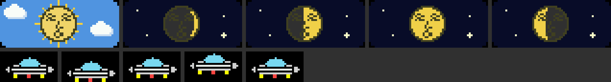

# Stage 3-3：顔のある太陽と月、昼夜の空、UFO

- 作成日：2026-10-21
- 状態：**ビルドと静的テストまで完了。実機ではまだ動かしていない**
- もとにした版：Stage 3-2（`firmware/RadioDays_3_2/` は変更せずに保存。SHA-256一致を確認）
- ソース：[../firmware/RadioDays_3_3/](../firmware/RadioDays_3_3/)
- 導入するファイル：**`firmware/RadioDays_3_3/RadioDays_3_3.ino.bin`**（app-only）

上段左から：昼（青空・雲・太陽）、夜の三日月、上弦、満月、下弦。下段：上下に浮くUFO。Macで同じ描画手順を再現した画像なので、実機とは少し違う（特にUFOの楕円）。

## 1. 変更内容

| 項目 | 内容 |
| --- | --- |
| 空の窓 | 時計の下に、62×25ピクセルの小さな窓（x＝176〜237、y＝45〜69）。画面全体の背景は変えない |
| 昼 | 青空、白い雲2つ、顔のある太陽（光線つき） |
| 夜 | 暗い夜空、小さな星3つ（1つは十字のきらめき）、顔のある月 |
| 太陽・月の大きさ | 直径19ピクセル（従来の月は15ピクセル）。SOUND TERRARIUMの顔が設計された大きさ（半径9〜10）に合わせた。太陽の光線は、窓に収まるよう短くした |
| 位置 | 日付・時刻の欄の水平方向の中央（x＝206） |
| 月の満ち欠け | Stage 2-5と同じ実際の月齢（北半球の向き）。その上に顔を描く |
| 日付・時刻 | 窓を入れるため、少し上に詰めた（日付 y＝20、時刻 y＝29〜44）。大きさは同じ。時計は従来どおり**日本時間** |
| 昼夜の判定 | **選択中のLocationの代表都市での太陽高度**が−0.833°より高ければ昼。固定の時刻では切り替えない |
| 判定の場所 | JAPAN＝東京、USA＝ニューヨーク、UK＝ロンドン、FRANCE＝パリ、WORLD＝東京（当面） |
| NTP同期前 | 昼夜を決めず、窓には何も描かない |
| 更新 | 太陽高度は1分に1回、またはLocationを変えたときに計算する。窓を描き直すのは、昼夜が変わったときと、月齢が1/64進んだとき（約11時間ごと）だけ |
| UFO | Location画面の右下（x＝196〜225、y＝96〜111）。地球儀、国名・都市名・局数、操作案内と重ならない。2.4秒周期で上下に2ピクセルだけゆっくり浮く。ランプは点滅しない |
| 顔とUFOの絵 | SOUND TERRARIUMの `drawClassicSun`・`drawClassicMoon`・`drawUfo` をもとにした（MIT、同じ作者） |

**太陽高度の関数は、緯度と経度を引数で受け取る**（`solarAltitudeDeg(utc, lat, lon)`）。将来、放送局ごとの所在地の空にするときも、この関数をそのまま使える。

**夜の月について**：夜の窓の月は演出で、その場所で実際に月が地平線の上にあることを意味しない。満ち欠けは実際の月齢に合わせている。

## 2. 変えていないもの（3-2との差分で確認）

再生用タスク、U135の判定、ノイズ、メーター、Wi-Fi、Wi-Fiの保存、AUTO／MANUALの選局、Locationの切り替え、地球儀の描画と回転、周波数表示。変えたのは、時計の欄の描き方と、Location画面へのUFOの追加だけ。

## 3. ビルド結果

| 項目 | 値 |
| --- | --- |
| アプリの大きさ | **1,355,184 B**（0x150000＝1,376,256 Bに収まる。残り21,072 B） |
| 静的RAM | data 23,252 B＋bss 35,440 B＝58,692 B |
| Location画面で追加で使うメモリ | UFOの画像 約1KB（地球儀の約29KBに加えて。画面を閉じると解放） |
| SHA-256 | `68d521f60f14491d6df8d5a6046e860d14373428be1acb392b7c2087aa6ab72d` |
| 警告 | 自分のコードの警告0件 |

## 4. 静的テスト（Mac上、スケッチから取り出したコード）

**日の出・日の入り：4都市×春分・夏至・秋分・冬至＝32件**

- 独立に書いたNOAAの計算式と比べて、すべて**0.05分以内**で一致
- 公表されている時刻（東京・ロンドン・ニューヨークの夏至と冬至）と比べて、すべて**1分以内**

| 例 | RADIO DAYSの計算 | 公表値 |
| --- | --- | --- |
| 東京 2025-06-21 | 04:25／19:00 | 04:25／19:00 |
| ロンドン 2025-12-21 | 08:03／15:53 | 08:04／15:53 |
| ニューヨーク 2025-06-20 | 05:24／20:30 | 05:25／20:31 |
| パリ 2025-06-21 | 05:46／21:57 | （参考） |

**昼夜の判定など（13項目すべて合格）**

| テスト | 結果 |
| --- | --- |
| 2025-06-21 12:00 UTC：東京（21時）は夜、ロンドン・パリ・ニューヨーク（8時）は昼 | 合格 |
| 2025-12-21 12:00 UTC：東京は夜、ロンドン・パリは昼、ニューヨーク（7時、日の出7:16の前）は夜 | 合格 |
| WORLDは東京と同じ空 | 合格 |
| 東京の夏至：日の出の10分前は夜、10分後は昼 | 合格 |
| ロンドンの冬至：日の入りの10分前は昼、10分後は夜 | 合格 |
| 春分の日の昼の長さ：4都市とも約12時間（12時間9〜11分） | 合格 |
| NTP同期前は窓に何も描かない | 合格 |
| UFOの位置が地球儀・文字・操作案内と重ならない | 合格 |
| UFOは1ピクセル動くときだけ描き直す（2.4秒に9回） | 合格 |
| 空の窓が時刻の下、目盛りの上に収まる | 合格 |

## 5. 実機確認の項目

| # | 確認すること | 期待する結果 |
| --- | --- | --- |
| 1 | 起動直後（NTP前） | 時計は `--:--`、空の窓は空っぽ |
| 2 | NTP同期後（昼） | 青空、雲、顔のある太陽。時刻・日付が読みやすい |
| 3 | 夜 | 暗い空、星、顔のある月。今日の月の形と比べる |
| 4 | Locationを変える | 窓の空がその都市の昼夜に変わる（例：日本の昼にUKへ → 夜または朝） |
| 5 | 周波数・メーター | 大きさと読みやすさがStage 3-2と同じ |
| 6 | Location画面 | 右下にUFOがゆっくり浮く。地球儀・文字・操作案内と重ならない |
| 7 | 音 | 窓の描き直し、UFOのアニメーションで音が途切れない |
| 8 | Stage 3-2の項目 | 選局、ノイズ、メーター、Location、地球儀（[stage-3.md](stage-3.md) 第7節） |

## 6. 未確認事項

- 実機での見え方（顔の線の太さ、夜の月の暗い部分の顔の見え方、空の色、星の明るさ）
- 太陽の光線が窓の上下の端に接している。気になる場合は短くする
- UFOの楕円の描かれ方（Macの画像は簡易的な描画）
