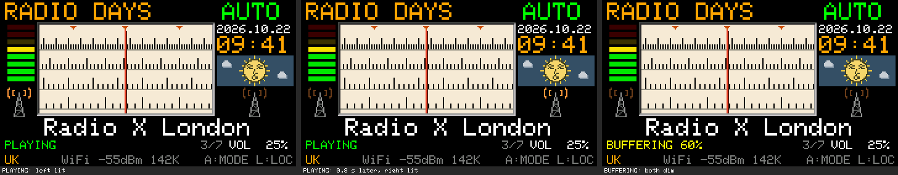
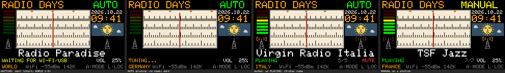
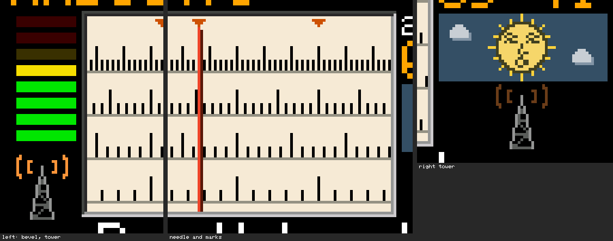

# U10：アイボリーの文字盤と電波塔

- 作成日：2026-10-22
- 状態：**実装、ビルド、Macでのホスト試験まで。実機（Cardputer ADV）ではまだ試していない**
- 追記（2026-10-22、公開準備）：**USB中継での動作と画面デザインを、作者が実機で確認**。**M5BurnerからUSBで `RadioDays_U10.ino.merged.bin` を書き込み、起動と動作を作者が確認**。Wi-Fiでの再生は確認の記録がなく、長時間の安定性は未確認（第8節）
- 設計：[dial-face-tower-proposal.md](dial-face-tower-proposal.md)（作者がB案を採用。局の印は濃いオレンジ、ミュート中はPLAYINGと同じ、BUFFERING・CONNECTINGは両方を弱く）
- もとにした版：U9（変更なし）。中継は U9 の `RadioDaysRelay_U9.command` をそのまま使う

## 1. U9からの変更（ラジオ画面だけ）

| 項目 | U10 |
| --- | --- |
| 文字盤 | アイボリー (240,234,214)（`DIAL_FACE`） |
| 目盛り | 黒（`DIAL_TICK_C`）。4段・間隔・長さ・動きはU9のまま |
| 基線（各段の横線） | 温かい灰 (150,145,132)（`DIAL_BASE_C`） |
| 局の印 | 濃いオレンジ (200,80,0)（`DIAL_MARK_C`。U9の琥珀色に戻すには、この定数を `COL_AMBER` にするだけ） |
| 外周 | 2ピクセルのくぼんだ縁取り：外側 x 30〜173・y 18〜93（上と左 (70,70,70)、下と右 (200,200,200)）、内側はU9の枠の線の位置 x 31〜172・y 19〜92（上と左 (40,40,40)、下と右 (150,150,150)）。外周だけで、目盛りを横切る線はない |
| 消す色 | U9で黒で消していた3か所（内側の塗り、目盛りを短くするとき、局の印を動かすとき）を文字盤の色に |
| 指針 | U9のまま (235,70,40)・(90,25,15) |
| 電波塔 | 左 x 6〜24・y 71〜94（レベルメーターの下）、右 x 197〜215・y 71〜94（空の窓の下）。塔の本体 (150,150,145)、横材と筋かい (95,95,92)。点の表（塔65点、電波36点を左右で共有）から描く。画面全体を描くときだけ |
| 電波 | 状態の行と同じ値で決める：PLAYING（ミュート中も）＝片側を点灯 (255,150,60)・反対側を弱く (110,62,28)、`WAVE_BLINK_MS`＝800ミリ秒ごとに左右を入れ替え。BUFFERING・CONNECTING＝両方を弱く。それ以外（WAITING、TUNING...、NO STATION、STOPPED、NO SIGNAL、UNAVAILABLE、USB RELAY REQUIRED など）＝消灯 |
| 描き方 | `drawRadio()`（100ミリ秒ごと、ラジオ画面のときだけ）で、片側の色が変わったときだけ、その側の電波の36点を描く。`delay()`、新しいタスク、画面全体の描き直し、画面外のキャンバスはない |
| 版の表示 | `U10` |

**変えていないもの**：7 Location・42局、局のデータとURL、AUTO・MANUAL（受信開始の条件、350ミリ秒）、U135、音声、ネットワーク、USB中継、NVS、時計、空、音量、`n/N`。試験1で、U10からこの表の変更を取り除くとU9のファイルと1文字も違わないことを確認した。`stations.h` と4つのヘッダーはU9と同じファイル。

点滅の速さを変えるには `WAVE_BLINK_MS`（例 1200）を、局の印の色は `DIAL_MARK_C` を直す。

## 2. ビルド

| 項目 | 結果 |
| --- | --- |
| 設定 | U9と同じ（m5stack:esp32 3.3.9、M5Cardputer、USB Mode：Hardware CDC and JTAG、USB CDC On Boot：Enabled、Flash 8MB、Partition：8M with spiffs〔大きさの確認用〕） |
| 結果 | 成功。RADIO DAYSのファイルからの警告0件 |
| **アプリの大きさ** | **1,371,360 B**（`RadioDays_U10.ino.bin`）。U9より **+720 B** |
| **0x150000までの残り** | **4,896 B**（Launcherの領域は変えていない） |
| 静的RAM | 59,796 B（U9と同じ） |
| 再現性 | 2回のビルドで同じSHA-256 |
| SHA-256 | `firmware/RadioDays_U10/SHA256SUMS.txt` |

設計の時の見込み（約0.5〜1 KB）の範囲だった。

## 3. 自動試験（`sh tools/u10-test/run_u10_test.sh`、`--live` で中継の実際の転送も）

| # | 試験 | 結果 |
| --- | --- | --- |
| 1 | U10のスケッチから変更を取り除くとU9のファイルと1文字も違わない。`stations.h` と4つのヘッダーはU9と同じ | **合格** |
| 2 | 文字盤：内側は文字盤・黒の目盛り・基線・局の印・指針の色だけ。`drawDial()` は縁取りの外に何も描かない。縁取りの位置と色。色の値 | **合格** |
| 2 | U9と同じ目盛り：全Location、7段ごとの位置（124場面）で、U10の「文字盤でない点」とU9の「黒でない点」が1点も違わない（色だけが変わった） | **合格** |
| 2 | **残像なし**：AUTOの1段ずつの移動（全Location、両方向、継ぎ目を越えて、1,750回）と、MANUAL・跳び（乱数と全局、1,442回）の後の画面が、毎回、その位置で全体を描いた画面と**1点も違わない** | **合格**（いちばん大きい違い 0点） |
| 2 | 動かしても指針と縁取りの点に一度も書かない（そこはちらつかない） | **合格** |
| 2 | 電波塔：左 x 6〜24・y 71〜94、右 x 197〜215・y 71〜94。上の行、レベルメーター、日付、時計、空の窓、ダイヤルと縁取り、19文字の局名の行、状態・`n/N`・音量の行、下の行に1点も重ならない。電波は塔の点に重ならない | **合格** |
| 2 | 電波と状態：BUFFERING・CONNECTINGは両方を弱く、WAITING、STOPPED、NO STATION、NO SIGNAL、UNAVAILABLE、NO STATION - RETRY、NOT ENOUGH MEMORY、TUNING...、USB RELAY REQUIREDは消灯、PLAYINGは800ミリ秒ごとに左右入れ替え | **合格** |
| 2 | 描く量：最初に両側（72点）、変わらない間は0点、BUFFERING→PLAYINGで片側（36点）、入れ替えで両側（72点）、WAITINGで両側を消す（72点）。塔は130点で画面全体を描くときだけ | **合格**（2の合計28項目） |
| 3 | U9の試験をU10のコードで：局の表、U8のAUTOの試験、`n/N`（49項目）、`freq_calc.py`、U4のホスト試験（55項目）、U9の中継の規則（41項目、`--live`） | **合格** |

**Macでしか確かめていないこと**：上はすべて、スケッチの関数をMacで動かした試験（画面は画素の配列）。実際の液晶の色の見え方、SPIの描画の速さ、音声との同時の動作は試していない。

## 4. 画面の見本（U10のコードがMacで描いた画素。実機の画素ではない）

ダイヤル・縁取り・電波塔・電波はU10の関数そのもの（グライドの場面は1段ずつ描いた結果）。ほかの部分はU9と同じ配置・色・本体の字体で描いた。

作り直し：`sh tools/u10-preview/make_u10_preview.sh`。

## 5. 書き込み方法（U9までと同じ）

以下はLauncherでapp-onlyの `.bin` を導入する方法。Launcherを使わずにフラッシュ全体を書き込む方法（M5Burnerと `RadioDays_U10.ino.merged.bin`）は第8節とREADMEを参照。

1. Launcherで、`firmware/RadioDays_U10/RadioDays_U10.ino.bin`（app-onlyの `.bin`）を導入する：SDカードにコピーしてLauncherから選ぶか、LauncherのWi-Fiアップロード（WebUI）で送る（[stage-2-1.md](stage-2-1.md) と同じ手順）
2. `RadioDays_U10.ino.merged.bin`、Arduino IDEの「書き込み」、esptoolは使わない。**本体への直接の書き込み、パーティションの変更、NVSの消去はしない**
3. 起動するとSTART画面の右上に `U10`
4. USB中継で聴く場合は、Macで `tools/usb-relay/RadioDaysRelay_U9.command` を使う（U10の局はU9と同じ）
5. 保存したLocationとWi-FiはU9と同じ記録をそのまま使う（U9に戻すときも同じ）

## 6. 実機で確かめること

| # | 項目 |
| --- | --- |
| 1 | 文字盤：アイボリーと黒の目盛りの見え方、縁取りのくぼんだ感じ、局の印の濃いオレンジと指針の色の釣り合い（必要なら `DIAL_MARK_C` を琥珀色に） |
| 2 | AUTOのグライド・MANUALで、黒い残像やちらつきがないこと（Macの試験では0点） |
| 3 | 電波塔の大きさ・位置、局名・空の窓・レベルメーターとの間隔 |
| 4 | 電波：PLAYINGで左右が交互に（0.8秒）、BUFFERING・接続中に弱く、WAITING・TUNING...・局の間で消える。せわしなければ `WAVE_BLINK_MS` を1200に |
| 5 | ミュート中も電波はPLAYINGと同じ |
| 6 | **音切れがないこと**（電波の描き直しは0.8秒ごとに最大72点。音声は別のタスク） |
| 7 | U9と変わらないこと：選局、`n/N`、時計、空、音量、Wi-Fi・USB中継、Locationの切り替えと保存 |

配信の利用条件は、U9と同じく未確認のまま（技術の確認とは別）。

## 7. ファイル

| ファイル | 内容 |
| --- | --- |
| `firmware/RadioDays_U10/RadioDays_U10.ino.bin` | Cardputerに入れるファイル |
| `firmware/RadioDays_U10/RadioDays_U10.ino` | スケッチ（U9から変えたのは第1節の部分だけ） |
| `firmware/RadioDays_U10/stations.h` ほか4つ | U9と同じ |
| `firmware/RadioDays_U10/SHA256SUMS.txt` | U10の成果物のSHA-256 |
| `tools/u10-test/run_u10_test.sh`、`u10_test.cpp` | U10のホスト試験 |
| `tools/u10-preview/make_u10_preview.sh`、`u10_dump.cpp`、`compose_u10_preview.py` | U10のコードで描いた画面の見本 |
| `docs/images/u10-*.png` | 画面の見本 |

## 8. 実機での確認と配布用の全体イメージ（2026-10-22追記、公開準備）

### 8.1 実機での確認状況

| 項目 | 状況 |
| --- | --- |
| USB中継での再生、画面デザイン（文字盤、縁取り、電波塔） | 作者が実機で確認 |
| M5BurnerからUSBで `RadioDays_U10.ino.merged.bin` を書き込み、起動と動作 | 作者が実機で確認（M5Burnerへの登録は作者が実施。2026-10-22にM5Burnerで公開済み。作者がM5BurnerのUser Custom画面で「Published At: 2026-10-22」を確認） |
| Launcher 2.9.1でapp-onlyの `.bin` を導入 | Stage 2-1までと同じ手順。U10としての記録はない |
| Wi-Fiでの再生 | 確認の記録なし（実機写真の画面にWi-Fiの電波強度が出ているが、記録がないため未確認として扱う） |
| 長時間の安定性 | 未確認 |

スケッチ冒頭のコメント（「Not yet run on hardware」、古い操作一覧）は、U10を保存版として変えないため、そのままにしている。現在の状況と操作はREADMEに書く。

### 8.2 `RadioDays_U10.ino.merged.bin`

| 項目 | 内容 |
| --- | --- |
| 用途 | M5Burnerなどでフラッシュ全体（アドレス0x0から）に書き込む。**Launcherと、Launcherで導入したアプリは消える** |
| 内容 | ブートローダー、パーティション表、`boot_app0`、U10のアプリ（Arduino IDEの「コンパイルしたバイナリを出力」で作成） |
| ビルド設定 | ボード M5Cardputer（`m5stack:esp32` 3.3.9）、USB Mode：Hardware CDC and JTAG、USB CDC On Boot：Enabled、**Flash Size：4MB**、**Partition Scheme：Huge APP (3MB No OTA/1MB SPIFFS)** |
| サイズ | 4,194,304 B |
| SHA-256 | `940735c5f2cf2b6963f14983f1923d0bde63ccc8a297e275bf67fc6309a92303` |

- app-onlyの `RadioDays_U10.ino.bin`（Flash Size 8MB、8M with spiffs）とはフラッシュの設定が違うため、merged.binの中のアプリはapp-onlyの `.bin` と1バイト単位では一致しない。ソースはどちらも同じ（第7節のファイル）
- `SHA256SUMS.txt` は第2節で作ったもので、merged.binを含まない。保存版のため書き換えず、merged.binのSHA-256はこの節、README、`THIRD_PARTY_NOTICES.md` に記録する

### 8.3 ビルドに使ったライブラリの版

ESP8266Audio 2.4.1、M5Cardputer 1.1.1、M5Unified 0.2.25、M5GFX 0.2.32。

- 作者のMacでは、2026-10-22 15:22（両方のバイナリを作った後）に M5Unified が0.2.27、M5GFX が0.2.34 に更新されている
- 確認（Mac、2026-10-22）：M5Unified 0.2.25 と M5GFX 0.2.32 を別の場所に置いてapp-onlyの設定でビルドし直すと、配布している `RadioDays_U10.ino.bin` との差は、バイナリに入るライブラリの場所（3か所）の文字数の差と、その後の位置合わせの8 Bだけだった。新しい版のライブラリでは、差がこれより大きい。このため、配布しているバイナリは上の版で作ったと判断した
- 作り直したバイナリは、ビルドしたマシンのファイルの場所が入るため、1バイト単位で一致するとは限らない

### 8.4 公開リポジトリでの試験用ツール

`tools/u10-test/run_u10_test.sh` は `firmware/RadioDays_U9/` と `tools/u9-test/` を、`tools/u10-preview/` のスクリプトは `tools/dial-preview/` を使う。これらは公開していない（`.gitignore` で除外）ため、cloneした環境では動かない。作者の開発環境でのみ使う。U10の `SHA256SUMS.txt` の対象なので、ツール自体は変えていない。

