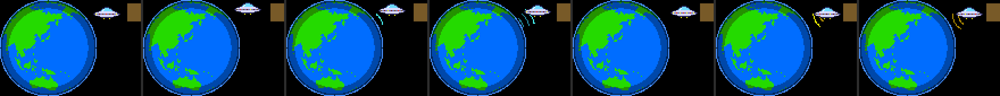

# U2a3：Location画面のUFOの浮遊と交信、プログラム容量の調査

- 作成日：2026-10-21
- 状態：**2026-10-21 実機試験合格（作者。第7節）**。UFOの演出は完成。音切れは既知の制約として記録した（第7.3節。解消はしていない）。U2a3はこの状態で確定し、変更しない
- もとにした版：U2a2（2026-10-21に実機試験済み。`firmware/RadioDays_U2a2/` は変更せず保存。いつでも戻せる）
- Stage 3-3以前、U1、U2a、U2a2のファイルは変更していない（SHA-256の一致を確認）
- **Macの中継スクリプトは、U2a2と同じ `RadioDaysRelay_U2a2.command` を使う**（やり取りは変えていない）

---

## 1. 変更の内容（U2a2との差分）

**変えたのは、Location画面のUFOの描き方だけ。** USB中継のやり取り、Mac側のスクリプト、ラジオの再生、Wi-Fi、選局、音量、画面の切り替えは、U2a2のコードのまま。

| ファイル | U2a2との差分 |
| --- | --- |
| `RadioDays_U2a3.ino` | 冒頭の説明、`BUILD_TAG`（"U2a3"）、導入の注意のファイル名、UFOの部分（`ufoReset`・`ufoPoseAt`・`talkDraw`・`ufoDraw`）、Location画面を開くときの `ufoReset()` の1行。134行追加、30行削除。**この5か所のほかは同じ**（`diff` で確認） |
| `radiodays_types.h` | `UfoPose` に、ランプの点滅（`lampMode`）と電波（`wave`・`waveStep`）を追加 |
| `radiodays_link.h`、`stations.h`、`globe_land.h`、`AudioOutputM5Speaker.h` | **U2a2とまったく同じ**（`cmp` で確認） |

### 1.1 UFOの配置と浮遊

| 項目 | U2a2 | U2a3 |
| --- | --- | --- |
| 動き | 地球儀の右側を大きく周り、上下の奥に隠れる（20秒のうち約8秒は見えない） | **地球儀の右上で、狭い範囲をふわふわ漂う。常に全体が見える** |
| ドット絵 | 24×12 | 同じ（そのまま使用） |
| 中心の位置 | ― | 地球儀の画像の (93, 10)。**画面では x＝97、y＝37**（地球儀の右上、国名の左） |
| 範囲 | ― | 左右±5ピクセル、上下±3ピクセル（実測） |
| 浮遊の作り方 | ― | 横は6.1秒と2.3秒、縦は3.7秒と1.9秒の、周期の違う2つの波を足したもの。乱数は使わない |
| 速さの変化 | ― | 速さそのものが19秒周期でゆっくり上下し（35〜100%）、23秒ごとに約3秒かけて、いったん止まってまた動き出す |
| ランプ | 0.4秒ごとにゆっくり流れる | 同じ |

- UFOが動ける範囲（画面の x＝79〜114、y＝28〜46）は、国名の欄（x＝116から）にかからない。地球儀の円の上には描かない（U2a2と同じ）
- 10分間の計算で、UFOの147個の点が**常にすべて見えた**

### 1.2 地球との交信

| 段階 | 時間 | 内容 |
| --- | --- | --- |
| 待機 | 15〜25秒（毎回少し変える） | 浮遊だけ |
| 地球→UFO | 1.3秒 | 地球のふちから、UFOに向かって**シアンの円弧**が1本ずつ現れ、広がりながら進む（最大3本。先頭が明るく、後ろは暗い） |
| UFOが受信 | 0.6秒 | 外周の7つのランプが、0.1秒ごとに全部点く・全部暗くなる |
| UFO→地球 | 1.3秒 | UFOから地球に向かって、**黄色の円弧**が同じように進む |
| 待機に戻る | ― | 何事もなかったように浮遊を続ける |

- Location画面を開いてから約8秒後に最初の交信。その後は、交信の終わりから15〜25秒後に次の交信（始まりから次の始まりまでは18〜28秒）
- 電波の線は1ピクセルの細さ。地球儀の円の上には描かない（地球の上から出ていくように見える）
- **実際のUSBやWi-Fiの通信とは関係ない**飾り。再生していなくても動く




### 1.3 描き方（ちらつきと再生への配慮）

| 要望 | 対応 |
| --- | --- |
| 同じ描画処理で合成 | 地球儀、UFO、電波を、1枚の画像（112×85、8ビット）に描いてから、一度に送る（U2a2と同じ方式） |
| ちらつかない・跡が残らない | 毎回、画像全体を描き直してから送る |
| 再生を止めない | `delay()` は使っていない。描き直すのは、UFOが1ピクセル動いたとき、ランプが変わったとき、電波が進んだとき（ループの中で、時刻を見て判断）。最大で毎秒30回、平均で毎秒約8回（10分間の計算） |
| 地球儀が主役 | UFOと電波は地球儀の円の上に描かない。電波は細く、短い時間だけ |

## 2. ビルド

| 項目 | U2a2 | U2a3 |
| --- | --- | --- |
| アプリの大きさ | 1,360,752 B | **1,361,904 B**（+1,152 B） |
| 0x150000（1,376,256 B）までの残り | 15,504 B | **14,352 B** |
| Launcherが作る領域 | 0x150000 | 0x150000（変わらない） |
| 静的RAM | 58,980 B | 59,004 B |
| SHA-256 | `0309d1d4…` | `8523189ab7a9ef50bf799dfdffdc2db07d6f8b1ce6ac9816fad0b82ac23f93bc` |
| 警告 | 0件 | 自分のコードの警告0件 |

## 3. 試験

### 3.1 UFOの試験（スケッチのUFOのコードをそのまま取り出し、Macで10分間動かす）

```bash
sh tools/ufo-test/run_ufo_test.sh
```

| 確かめたこと | 結果 |
| --- | --- |
| 地球儀の円の上に描いた点 | **0** |
| UFOの見えている点 | **常に147／147** |
| 浮遊の範囲 | 左右−5〜+5、上下−3〜+3ピクセル |
| 交信の回数と間隔 | 10分で26回。始まりから次の始まりまで18.2〜27.5秒 |
| 描き直しの回数 | 平均で毎秒8.2回（33ミリ秒ごとの判断のうち約27%） |
| 国名の欄（画面のx≧116）にかかる点 | 0（描画範囲がx＝115で終わる） |

### 3.2 回帰試験（U2a2のシミュレーション）

U2a3のリンクの処理とMacのスクリプトは、U2a2とまったく同じファイルなので、U2a2の `sim2` をそのまま実行した。

シミュレーションでわかるのは、やり取りの正しさだけ。Location画面の描画が実機の再生に与える影響は、実機で確かめる（第5節の手順1）。

### 3.3 回帰試験の結果

| 試験 | 結果 |
| --- | --- |
| `sh tools/usb-relay/sim2/run_sim.sh` | **41項目すべて合格**（混入なし、分割受信、偽の返事、許可ホストとポート、行の損失と切断で止まらない、`isPlugged()` だけがfalseでも影響なし、スクリプトの停止と再起動でHELLOが続き戻る、TUNEの再送、バッファーの枯渇と再充填、あふれ0） |
| `sh tools/usb-relay/sim2/run_sim.sh --negative`（確認用） | 883,616バイトのあふれを検出（テストが正しく働く） |

## 4. プログラム容量の調査

**実際のビルド結果（U2a3）と、使っているパーティションの設定をもとにした。** パーティション構成とLauncherの起動方式は変えていない。ほかのアプリには触れていない。

### 4.1 今のパーティション構成

| 区別 | 内容 | 根拠 |
| --- | --- | --- |
| ビルド時の設定 | 「8M with spiffs（3MB APP/1.5MB SPIFFS）」＝`default_8MB.csv`：`app0` 0x10000から0x330000（3,342,336 B）、`app1` 同じ大きさ、`spiffs` 0x180000、`coredump` 0x10000 | m5stack:esp32 3.3.9の `tools/partitions/default_8MB.csv`、`boards.txt`（`upload.maximum_size=3342336`） |
| ビルド時の設定の役割 | Arduinoが**大きさを検査するためだけ**に使う。導入するapp-onlyの `.ino.bin` には、パーティション表は入っていない | 設計書3.5.2節 |
| 実機の構成 | Launcher 2.9.1が管理する。Launcher自身は `app0`（0x10000から0x150000の大きさ）、`nvs` 0x9000、`otadata` 0xE000、`coredump` | 設計書3.5.1節【確認：Launcher 2.9.1のソース】 |
| 導入したアプリの領域 | Launcherが、**アプリの大きさを64KB単位に切り上げた大きさ**で、空いている場所に新しく作る。新しい版を導入するたびに、新しい領域が作られる | 同上（`alignUp(imageSize, 0x10000)`）、Stage 2-2以降の記録 |

### 4.2 大きさの上限はどこで決まっているか

| 上限 | 値 | 性質 |
| --- | --- | --- |
| ビルドの検査 | 3,342,336 B | Arduinoの検査だけ。実機の上限ではない |
| **Launcherが作る領域** | 大きさを64KB単位に切り上げた値。U2a3は1,361,904 B → **0x150000（1,376,256 B）** | 実機の空き（PManのFREE）が、これ以上あれば導入できる |
| **「0x150000以内」** | 1,376,256 B | **RADIO DAYSの開発上の決まり**（U2の設計で作者が決定）。Stage 2-1以降のすべての版が0x150000の領域に入っていたことから来ている。ハードウェアやLauncherの上限ではない |

つまり、0x150000を超えると、**Launcherは0x160000（1,441,792 B）の領域を作る**だけで、導入の方式は変わらない【確認：Launcher 2.9.1のソース。実機では未確認】。

### 4.3 Launcherとの互換性を保ったまま広げられるか

| 項目 | 内容 |
| --- | --- |
| 可能性 | **ある。** アプリが大きくなると、Launcherが作る領域が64KBずつ大きくなる（0x160000、0x170000…）。アプリの作りや導入の手順は変わらない |
| 条件 | 実機の空き（PManのFREE）が、その大きさ以上あること。Stage 2-1のころは約4MBの連続した空きがあった（作者の確認）。**今の空きは未確認**（U1・U2a・U2a2などの版が、それぞれ領域を使っている） |
| 注意 | 空きが足りないと「Need …」の画面が出る。**必ず「Cancel」**（ほかのアプリを上書きする選択肢がある）。古い版の領域を消せるか（Launcherの機能）は、実機で確かめる必要がある【未確認】 |
| パーティション構成の変更 | 不要。Launcherの構成も、起動方式も変えない |

### 4.4 機能を保ったまま減らせるところ（U2a3の実測）

**全体の内訳**（リンカーのマップから。主なもの）

| 部分 | 大きさ | 減らせるか |
| --- | --- | --- |
| Wi-Fi（`libnet80211`・`libpp`・`libwpa_supplicant`・`libphy`）＋通信（`liblwip`）＋暗号（`libmbedcrypto`、WPA2に必要） | 約53万B | Wi-Fiで再生する限り、減らせない |
| MP3デコーダー（ESP8266Audio。`layer3`・`huffman`・`synth` で約9.8万B） | 約11.6万B | 減らせない |
| 画面（M5GFX） | 約10.8万B | 多くは、M5の機種の自動判別と複数の画面・機種への対応（`lgfx_v1_panel` 2.4万B、`lgfx_v1_platforms` 2.1万B、`M5GFX.cpp` 1.9万B）。Cardputer専用の設定にすれば数万B減る可能性があるが、画面の初期化を変えるので、実機での確認が必要【推測】 |
| M5Unified | 約5.6万B | 多くの機種への対応を含む。ライブラリを改造しない限り減らせない |
| RADIO DAYS自身のコードと定数 | 約5.1万B | 下の表 |
| そのほか（Arduinoのコア、FreeRTOS、NVS、標準ライブラリなど） | 残り | 減らせない |

**RADIO DAYS自身の部分で減らせるところ**

| 候補 | 減らせる量 | 影響 |
| --- | --- | --- |
| 地球儀の地図（4,096 B）を行ごとのランレングス圧縮に | 約2.3KB（圧縮後 約1.7KB。実測） | 地球儀の画面を開くときに展開する（約4KBのRAMを使う。または描くたびに展開） |
| シリアルの記録の文字列（`[`で始まる46行、1,653 B） | 約0.5〜1KB | 短くすると、試験のときの手がかりが減る |
| すべての文字列（221個、4,147 B） | 上と重なる | ― |
| 最適化の設定 | ― | すでに大きさ優先（`-Os`）。変えられる余地はない |

**→ RADIO DAYS自身の工夫で減らせるのは、合わせて3KB前後。** 大きく減らすには、ライブラリの側（画面の設定）か、機能（Wi-Fi）に手を入れる必要がある。

### 4.5 容量が足りなくなったときの現実的な対策（おすすめの順）

| 順 | 対策 | 効果 | 費用・注意 |
| --- | --- | --- | --- |
| 1 | **「0x150000以内」の決まりを、0x160000（または0x170000）に広げる** | +64KB（+128KB） | コードの変更なし。導入の前に、PManの空きを確かめるだけ。決まりを変えるかは、作者の判断 |
| 2 | 地球儀の地図の圧縮と、記録の文字列の整理 | 約3KB | 小さな変更。いまの決まりを少し長く守れる |
| 3 | 画面のライブラリを、Cardputer専用の設定で使う | 数万B【推測】 | 画面の初期化を変える。実機での試験が必要。M5Cardputerライブラリとの関係を調べる必要がある |
| 4 | Wi-Fiを使わない「USB専用」の版を別に作る | 約50万B（U1は700,880 B） | 家などでWi-Fiで聴けなくなる。U2bの自動切り替えとは両立しない |

**まず確かめてほしいこと**：LauncherのPManで、今の空き（FREE）と、RADIO DAYSの古い版が使っている領域。

## 5. 実機で確かめる手順

### 準備

1. **PManで、空き（FREE）が0x150000（1,376,256 B）以上あることを確かめる**（U2a3は新しい領域に入る）
2. Launcherで `firmware/RadioDays_U2a3/RadioDays_U2a3.ino.bin` を入れる（「Need …」が出たら「Cancel」）。起動画面の右上が「U2a3」
3. Macでは、**U2a2と同じ** `RadioDaysRelay_U2a2.command` を使う

### 手順1：Location画面を開いたままのUSB再生（最も大事）

1. USB中継で再生を始め、`L` でLocation画面を開く
2. **そのまま15分以上**、音を聴く。途切れや雑音がないか
3. ターミナルの `Cardputer> [DIAG]` の行で、`underruns` が増えないか、`gap-loop`・`gap-link`・`gap-decode` がラジオの画面のときと比べて大きくなっていないかを見る
4. ターミナルの `[relay]` 行で、送信が約16KB/秒で続くか
5. 同じことを、地球儀が回り続ける **WORLD** を選んだ状態でも行う（描き直しが最も多い）

### 手順2：UFOの見た目

| 確かめること | 期待すること |
| --- | --- |
| 位置 | 地球儀の右上、国名の左で、ゆっくり漂う。常に全体が見える |
| 文字 | 国名・都市名・「(now)」・局名が隠れない |
| 動き | 滑らかで、ときどきゆっくりになり、短く止まる |
| 交信 | 画面を開いて約8秒後、その後は約20秒ごとに、シアンの電波→ランプの点滅→黄色の電波 |
| 品質 | 跡やちらつきがない。地球儀の回転も今までどおり |
| 切り替え | JAPAN〜WORLDの選択、Locationの切り替え（「TUNING TO …」）の後も崩れない |

### 手順3：今までの機能（U2a2と同じこと）

- USB中継での選局（AUTO、MANUALのノイズ）、音量、ミュート、画面の切り替え
- Macのスクリプトを止めて起動し直すと、すぐに戻る
- 家（スクリプトなし）で、Wi-Fiで再生できる

## 6. 未確認事項

| 項目 | 内容 |
| --- | --- |
| Location画面を開いたままの再生の安定 | U2a2では安定していた。U2a3は描き直しの回数が変わる（平均で毎秒約8回）。実機で確かめる |
| UFOと電波の見た目 | Macで同じコードを動かした図だけ。実機の色と大きさは未確認 |
| 0x150000を超えたときのLauncherの動き | ソースでは確認済み。実機では未確認 |
| 実機の今の空き容量 | 未確認（PManで確かめる） |

## 7. 実機試験の結果（2026-10-21、作者）

**判定：合格。** 理由（作者）：

1. UFOのアニメーションが期待どおりに動作した
2. UFOを表示していても、安定して再生できる時間があった
3. 音切れは通常のラジオ画面でも起きており、UFOの表示だけの問題とは考えにくい
4. USBの接続は安定し、L3を保った
5. 一時的な音切れの後、再生が自動で戻ることを確認した

音切れの完全な解消は、U2a3の完成の条件としない（作者の判断）。

### 7.1 試験の環境

| 項目 | 内容 |
| --- | --- |
| 本体 | M5Stack Cardputer ADV（＋U135） |
| ファームウェア | U2a3 |
| Macの中継 | `RadioDaysRelay_U2a2.command`（変更なし） |
| 放送局 | Japan Hits |
| 音量 | 64 |

### 7.2 UFOのアニメーション

- 地球儀、UFOの浮遊、交信の電波が、期待どおりに表示された
- 表示の品質に問題はない。**追加の変更や調整は不要**（作者）

### 7.3 音声の再生と画面（同じ局を再生しながら切り替えて比べた）

| 時刻 | 画面 | 再生 |
| --- | --- | --- |
| 12:13〜12:17 | UFO（Location画面） | 一時的な音切れあり |
| 12:17〜12:24 | 通常のラジオ画面 | 音切れなし |
| 12:24〜12:29 | UFO | 音切れなし |
| 12:30ごろ | UFO | 音切れ。その後いったん回復 |
| 12:31〜12:33 | 通常のラジオ画面 | 音切れが頻発 |

**12:30以降の記録**（受信の速さはMacの `[relay]`、バッファーとunderrunsはCardputerの記録）

| 時刻 | 放送局からの受信 | バッファー | underruns |
| --- | --- | --- | --- |
| 12:29:55ごろ | 15.6 KB/秒 | 99% | 4 |
| 12:30:05ごろ | 12.7 KB/秒 | 11% | 5 |
| 12:30:15ごろ | 6.4 KB/秒 | 4% | 5 |
| 12:30:35ごろ | 17.2 KB/秒 | 99% | 5 |
| 12:31:15ごろ | 10.1 KB/秒 | 65% | 8 |
| 12:31:35ごろ | 10.9 KB/秒 | 57% | 11 |
| 12:31:55ごろ | 8.1 KB/秒 | 78% | 15 |
| 12:32:35ごろ | 8.2 KB/秒 | 1% | 20 |
| 12:32:55ごろ | 5.6 KB/秒 | 0% | 20 |
| 12:33:05ごろ | 6.8 KB/秒 | 0% | 20 |

この間の状態：

- USBのリンクはL3のまま。`tx-fail` 0、`to-L0` 0
- Macの `[relay]`：「waiting for the station」がおおむね98〜100%、「waiting for credit」はおおむね0〜1%
- underrunsは4から20に増えた。通常の画面でもバッファーが0%まで下がった

**音切れについての記録（既知の制約）**

| 項目 | 内容 |
| --- | --- |
| 確認したこと | **音声ストリームの一時的な供給不足**。Macが放送局からのデータを待っている時間がほぼすべてで（98〜100%）、Cardputerのクレジットを待つ時間はほぼない（0〜1%）。受信の速さが128kbps（約16KB/秒）を下回ると、バッファーが減り、underrunになる |
| 起きる画面 | **UFOの画面と通常のラジオ画面の両方** |
| USBの接続 | L3を保った。行の書き損じ（`tx-fail`）も、L0への落ち込みもない |
| 回復 | 受信の速さが戻ると、バッファーが満ちて、**自動で再生が戻る**ことを確認した |
| 原因の場所 | **未確定**。Macの手前（放送局のサーバー、インターネット、職場のネットワーク、Macの受信）のどこかで遅くなっていると考えられるが、どこかは特定していない。Cardputerの処理とUSBの転送が原因である様子は、今回の記録には見られない（ただし、完全には否定していない） |
| 対策 | **現時点では、追加の対策はしない**（作者の判断）。インターネットラジオでは、放送局や通信環境による一時的な供給不足が起こりうる |

### 7.4 描画の負荷

| 項目 | 結果 |
| --- | --- |
| UFOの画面の `gap-loop` | ふだんは約20〜21ミリ秒 |
| UFOの画面の `gap-decode` | 約16〜18ミリ秒 |
| 画面を切り替えたとき | `gap-loop` が一時的に約80ミリ秒。それだけで音切れは起きていない |

### 7.5 空きヒープの差（約32KB）：コードで確認した結果

| 画面 | 空きヒープ（作者の記録） |
| --- | --- |
| 通常のラジオ画面 | 約142,148 B |
| UFOの画面（Location画面） | 約110,144 B |
| 差 | 約32,004 B |

**結論：Location画面を開いたときに地球儀とUFOのために確保し、閉じたときに解放するメモリによる。** 予想どおり、描画用の領域の確保と解放だった。

| 確保するもの | 大きさ | コード（`RadioDays_U2a3.ino`） |
| --- | --- | --- |
| 地球儀の画素ごとの緯度の表（`globeRow`） | 85×85＝7,225 B | `globeBegin()`、`malloc(GLOBE_D * GLOBE_D)` |
| 経度の表（`globeCol`） | 7,225 B | 同上 |
| 陰影の表（`globeDepth`） | 7,225 B | 同上 |
| 地球儀とUFOの画像（8ビット、112×85） | 9,520 B | `globeSprite->createSprite(GLOBE_CW, GLOBE_D)` |
| 小計 | **31,195 B** | |
| 画像の管理用の小さなオブジェクトと、確保ごとの管理情報 | 残り約0.8KB【推測】 | `new M5Canvas(&lcd)` ほか |

- 確保：Location画面を開くとき（`openLocationScreen()` → `globeBegin()`）
- 解放：Location画面を出たとき（`loop()` の中で、Location画面でなければ `globeEnd()`）。解放するので、ラジオの画面に戻ると空きヒープは元に戻る
- UFOと交信の電波は、この同じ画像の中に描いている。**UFOのための追加のメモリはない**（U2a2の8ビット画像の拡張分を含めて、上の表にすべて入っている）
- 地球儀を作れないほどメモリが足りないときは、文字の一覧に切り替わる（Stage 3-2からの作り）
- **メモリの漏れではない**：画面を出るたびに解放している。Location画面でも約110KBの空きがあり、再生に必要なメモリ（起動時に確保済み）とは別

## 8. U2a3の最終状態

| 項目 | 内容 |
| --- | --- |
| 判定 | **実機試験合格**（2026-10-21） |
| 導入するファイル | `firmware/RadioDays_U2a3/RadioDays_U2a3.ino.bin`（1,361,904 B、SHA-256 `8523189a…`） |
| Macの中継 | `tools/usb-relay/RadioDaysRelay_U2a2.command` |
| 既知の制約 | 放送局からの供給が一時的に足りないと、音切れが起きる（第7.3節）。自動で回復する。解消はしていない |
| 今後 | U2a3は変更しない。次の作業は [release-plan.md](release-plan.md) |
