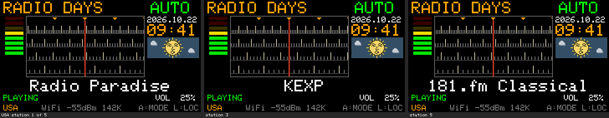
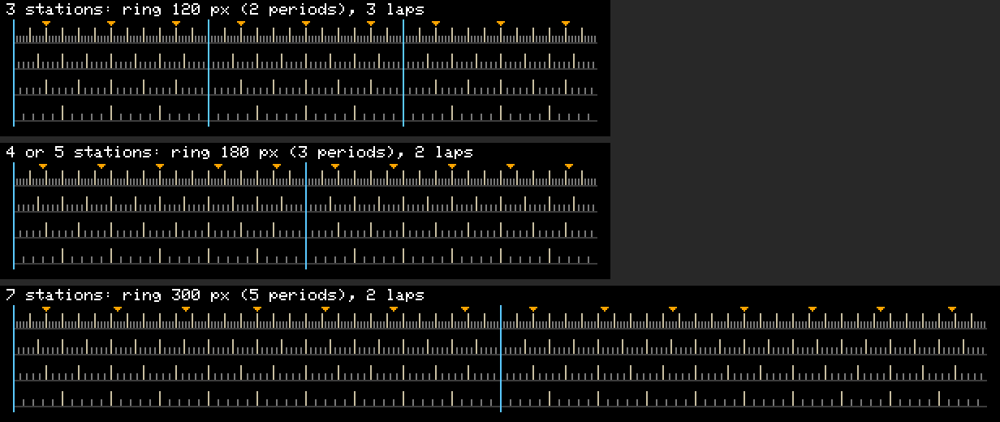

# U6：終わりのない、枠付きのアナログダイヤル

- 作成日：2026-10-22
- 状態：**実装、ビルド、ホスト試験まで。実機ではまだ試していない**
- もとにした版：U5（作者が実機で確認。変更なし）。中継は `RadioDaysRelay_U4.command` をそのまま使う
- 作者の方針（2026-10-22）：①すべての段を等間隔に、②停止線をなくし循環式に、③細い枠。追加の方針：**一周の長さは目盛りの共通周期の整数倍**にし、局数に応じて選ぶ（局間40 px・余白10段にはこだわらない）

## 1. 決めたこと

| 項目 | U6 | 理由 |
| --- | --- | --- |
| 段数 | **4段** | 240×135の画面で5・4・3段を並べて比べた（[図](images/dial-u6-rows-5-4-3.png)）。5段は1段13ピクセルで窮屈、3段は窓が空いて見える。4段は目盛りが長く（長9・短4ピクセル）、段ごとの間隔の違いがはっきり読める |
| 目盛りの間隔 | **2・3・4・6ピクセル**、各段とも5目盛りごとに長い線 | 4段がそろって繰り返す周期が**60ピクセル**（10・15・20・30の最小公倍数）。2・3・4・5ピクセルだと周期が300ピクセルになり、3局のLocationで局の間が100ピクセル、7局では1局300ピクセル（または不ぞろい）になってしまう |
| 一周の長さ | 60ピクセル（30段）の整数倍。局数で選ぶ：3局→120 px（60段）、4局・5局→180 px（90段）、7局→300 px（150段） | 1局およそ20段（U5の手ごたえに近い）。式 `30 × round(2n/3)` 段 |
| 局の位置 | 一周を局数で等分（局 i は `(2i+1)×一周÷(2×局数)` 段）。継ぎ目の前後は半分ずつ | 局の間は18〜23段。どの局の間も（継ぎ目をまたぐ所も）差は1段以内 |
| 枠 | 1ピクセル、(96,96,96)、x 31〜172・y 19〜92 | メーター（〜x 27）・時計と空（x 176〜）との間は4ピクセル。指針（x 101・102、y 24〜91）と局の印（y 21〜23）は枠の内側 |
| 停止線 | なし | |

## 2. 循環の方式

- 局の位置（`dialFreq`）は一周の中を回る：MANUALは最後の位置の次が最初（`floorMod`）。AUTOはU5から次の局へ一周していた（変えていない）
- **目盛りは局の位置そのものから計算する**（帯の座標＝位置×2ピクセル）。一周が60ピクセルの整数倍なので、継ぎ目をまたいでも目盛りの絵は「2ピクセル（または局の間）ずれただけ」になり、跳ばない。何周しても、同じ局の下には同じ目盛りが来る
- 局の印も一周ごとに繰り返して描く（3局のLocationは一周120ピクセルが窓より短いので、最初の局の左に最後の局の印が見える）
- U5から変えた選局の処理は**MANUALの1行だけ**（端で止まる→一周する）。局の間の雑音、350ミリ秒で受信開始、AUTO、モード切替、音量、ミュートはU5のまま
- 第1案として、目盛りを「巻き戻らない移動量」から描く方式を一度実装したが、追加の方針（一周＝周期の整数倍）に合わせて作り直した。こちらの方がコードも少ない

## 3. U5から変えたファイル

| ファイル | 内容 |
| --- | --- |
| `RadioDays_U6.ino` | 見出しの説明、`BUILD_TAG`、MANUALの一周（1行と小さな関数2つ）、ダイヤルの描画（4段、等間隔、枠、停止線なし、一周ごとの局の印） |
| `stations.h` | 一周の長さと局の位置の値（局名、URL、局とLocationの順番は同じ。比較で確認）。ビルド時の検査 |
| ほかの4つのヘッダー | U5と同じ |

## 4. 容量と描画量

| 項目 | U5 | U6 |
| --- | --- | --- |
| アプリの大きさ | 1,374,032 B | **1,373,408 B（−624 B）** |
| 0x150000までの残り | 2,224 B | **2,848 B** |
| 静的RAM | 59,756 B | 59,756 B |
| MANUAL 1段の描画（最大） | 311回・1,900画素 | 274回・1,787画素（約1.5 ms【推定】） |
| AUTO 1局（最大） | 307回・1,876画素 | 271回・1,776画素 |
| 画面に入ったとき | 11,648画素 | 12,106画素（枠の分） |

描画の仕組みはU5と同じ：`drawRadio()`（100ミリ秒ごと、値が変わったときだけ）の中で、変わった列だけを描き直す。枠と指針は画面全体を描くときだけ。タスク、待ち、画面外キャンバス、動きの演出は使っていない。音声・USB・Wi-Fiの処理は変えていない（`decodeTask` などはU5と同じ）。

## 5. 試験

```bash
sh tools/u6-test/run_u6_test.sh          # ダイヤル・一周・選局・最下行（22項目）と、U4のホスト試験（55項目）
sh tools/u6-test/compare_with_preview.sh # ファームウェアの描画とプレビューの比較
```

| 試験 | 結果 |
| --- | --- |
| ダイヤルと一周（新規） | **22項目すべて合格**：一周が60 pxの整数倍、局が等分（間18〜23段）、4段がそろって60 pxで繰り返す、各段の間隔（2・3・4・6）と5本ごとの長い線、枠、枠の内側の指針、停止線なし、AUTO・MANUALで左右とも一周（全19か所）、継ぎ目でも局の間と同じ雑音、一周で同じ局に戻る、**継ぎ目を含むどの1段・1局の移動も、前の絵をちょうどその分ずらした絵になる（2周以上、跳び0画素）**、1万回の移動の後も全体を描いた絵と1画素も違わない、枠と指針を描き直さない、Locationの切り替え、局の印の位置、最下行 |
| 試験の確認 | 目盛りを2・3・4・5ピクセルに戻すと、継ぎ目で81画素の跳びを検出して不合格になる |
| プレビューとの比較 | 9つの場面で**0画素の違い**（枠を含む） |
| U4のホスト試験をU6のコードで | 55項目すべて合格（Wi-Fi、NVS、USBのみ、Location、案内） |
| ビルド | 0x150000以内、自分のコードの警告0件 |
| リンク、人工衛星、デコード | U5と同じファイル・関数（比較で確認） |

## 6. プレビュー（240×135の画面、本体の字体）

- 段数の比較：[images/dial-u6-rows-5-4-3.png](images/dial-u6-rows-5-4-3.png)
- 同じLocationの3局（USA 1・3・5局目）：[images/dial-u6-three-stations.png](images/dial-u6-three-stations.png)
- 一周（HUNGARY：2→3→AUTOで1局目）：[images/dial-u6-ring-3.png](images/dial-u6-ring-3.png)
- 一周（JAPAN：6→7→AUTOで1局目）：[images/dial-u6-ring-7.png](images/dial-u6-ring-7.png)
- 帯を広げた図（青い線が一周の継ぎ目。どの周も同じ）：[images/dial-u6-laps.png](images/dial-u6-laps.png)
- 等倍：[images/dial-u6-actual.png](images/dial-u6-actual.png)





## 7. 実機で確かめること

1. 4段の目盛りと枠の見え方（明るさ、枠の色が他の表示と調和するか）
2. MANUALで回し続けたとき、左右とも目盛りが途切れず流れるか。継ぎ目で跳ばないか
3. AUTOで最後の局→最初の局（とその逆）
4. 局の印が指針に合い、受信が始まる。局の間の雑音
5. 3局（HUNGARY）・7局（JAPAN）のLocation
6. 再生中に回しても音切れが増えない（USB・Wi-Fi）

## 8. 未確認・注意

- 実機での動作全般（第7節）。描画時間は推定
- 局の位置の値が変わったので、シリアルの記録の `[TUNE]` の数字は意味のない値（画面には出ない。U5と同じ）
- 作業中に、U5の試験で作られたPythonのキャッシュ（`tools/dial-preview/__pycache__`、U5のチェックサムの対象外の生成物）を消した
