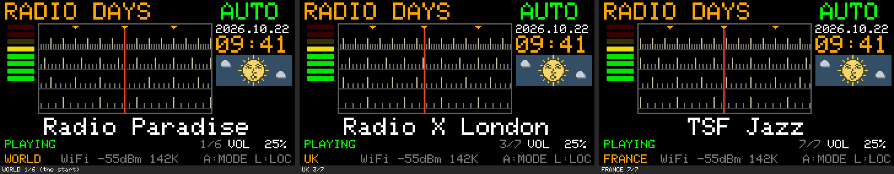

# U9：標準の7 Location・42局と、選局番号 n/N

- 作成日：2026-10-22
- 状態：**実装、ビルド、Macでのホスト試験まで。実機（Cardputer ADV）ではまだ試していない**
- 計画：[u9-implementation-plan.md](u9-implementation-plan.md)（第2節の局の表、第5節の表示、第7節の中継）。選局の調査：[location-selection-review.md](location-selection-review.md) と各国の資料
- もとにした版：U8（変更なし。19 Location・85局はU8に残る）。中継は新しい `RadioDaysRelay_U9.command`（U4の中継は変更なし）

## 1. U8からの変更

| 項目 | U9 |
| --- | --- |
| 局 | 作者が選んだ標準の7 Location・42局：JAPAN 5、USA 6、UK 7、FRANCE 7、WORLD 6、GERMANY 6、ITALY 5（`stations.h`。局名・URL・順・`freq` は計画の第2節のとおり） |
| Locationの順 | JAPAN、USA、UK、FRANCE、WORLD、GERMANY、ITALY（最初の5つはU3からの名前と位置のまま） |
| 起動時の既定 | 保存したLocationがなければ **WORLD**。その1局目が **Radio Paradise**（U8まではUSAの1局目がRadio Paradise）。最初に鳴る局は同じ |
| 選局番号 | ラジオ画面の状態の行、音量の左に、小さく暗い色で `n/N`（例 `3/7`）。人気の順位ではなく、そのLocationのダイヤルの何番目か |
| 版の表示 | START画面・シリアルの記録の `U9` |
| USB中継 | `RadioDaysRelay_U9.command`：許可するホストと転送の規則をU9の42局に合わせた（第4節） |
| 局の変更の手助け | `tools/freq-calc/freq_calc.py`（局数から `freq` の値を出す）、READMEの「放送局の追加・変更」 |

**変えていないもの**：ダイヤルの描画（4段の目盛り、オレンジの指針、枠、循環）、AUTOの滑らかな移動、MANUALの350ミリ秒、AUTO・MANUALの受信開始の条件、Locationの切り替えと保存、時計・タイムゾーン・昼夜、音量・ミュート、Wi-Fi・USBの再生、USBのリンクの約束。**スケッチはU8のファイルに、上の表の変更を加えただけ**（第3節の試験1で、U9から変更を取り除くとU8のファイルと1文字も違わないことを確認）。`AudioOutputM5Speaker.h`、`globe_land.h`、`radiodays_link.h`、`radiodays_types.h` はU8と同じファイル。

### 1.1 選局番号の表示

| 状態 | 表示 |
| --- | --- |
| 局の位置（AUTO・MANUAL） | `n/N` |
| AUTOで移動中 | なし（局名と同じ） |
| MANUALで局の間 | なし（局名と同じ） |
| 「Start the relay on your computer.」の案内の間 | なし |
| Locationを切り替えた | 新しいLocationの `1/N`（画面全体を描き直すので必ず更新） |
| 局が鳴らず自動で次の局へ進んだ | ダイヤルが動いた先の番号 |

- 番号は、局名の行と**同じ値**（`dialGliding() ? -1 : stationAtFreq(dialFreq)`）から決める。表示の処理は読むだけで、選局の変数に書き込まない（試験で確認）
- 位置：状態の文字（x 4〜153を消して描く）と音量（x 186〜）の間の x 154〜185。3・4文字（`1/5`〜`9/9`、`9/12`）は x 181で終わる（音量の前に5ピクセルの空き）。5文字（`10/12`〜`99/99`）は x 154から始まり、音量の直前まで使う（空きは1ピクセル）。**100局以上は表示しない**
- 画面の見本（Macで本体の字体を使って描いたもの。実機の画素ではない）：[images/u9-position-playing.png](images/u9-position-playing.png)、[images/u9-position-long-texts.png](images/u9-position-long-texts.png)

## 2. ビルド

| 項目 | 結果 |
| --- | --- |
| 設定 | m5stack:esp32 3.3.9、M5Cardputer、USB Mode：Hardware CDC and JTAG、USB CDC On Boot：Enabled、Flash 8MB、Partition：8M with spiffs（大きさの確認用。Launcherの領域は変えない） |
| 結果 | 成功。RADIO DAYSのファイルからの警告0件 |
| **アプリの大きさ** | **1,370,640 B**（`RadioDays_U9.ino.bin`）。U8は1,374,400 B（−3,760 B） |
| **0x150000までの残り** | **5,616 B**（U8は1,856 B） |
| 静的RAM | 59,796 B（U8より+16 B） |
| 再現性 | 同じソースを2回ビルドして同じSHA-256。U8を同じ方法で作り直すと、記録したU8のバイナリと同じSHA-256 |
| SHA-256 | `firmware/RadioDays_U9/SHA256SUMS.txt` |
| 注意 | Arduino IDE同梱の `arduino-cli` は、`--output-dir` を付けてもスケッチのフォルダに `build/` を作る。U8の確認のビルドとU9のビルドでできた `build/` は消した（U8のファイルとSHA-256は変わっていない） |

計画では局を減らした分を「約3.5〜4.5 KBの減少」と推測していた。実測は −3,760 B（`n/N` の表示を含む）。

## 3. 自動試験（`sh tools/u9-test/run_u9_test.sh`）

| # | 試験 | 結果 |
| --- | --- | --- |
| 1 | U9のスケッチから変更（説明、`.bin` の名前、`BUILD_TAG`、表示の値2つ、`dialPositionText()`・`dialPositionX()`、表示の処理）を取り除くと、U8のファイルと1文字も違わない。ほかの4つのヘッダーはU8と同じ | **合格**（これでダイヤル、AUTO、MANUAL、Location、時計、音声、USB、Wi-FiがU8のコードであることを確認） |
| 2 | 局の表：7 Locationの順と局数、42局、計画の表と名前・URL・順・`freq` が一致、位置の式、一周の長さ（5局90段、6局120段、7局150段）、URLが `http://` でIPアドレスでなく300文字未満、局名がASCIIで19文字以内、タイムゾーンがU8と同じ、既定がWORLDとRadio Paradise | **合格** |
| 2 | U8のAUTOの試験（23項目）をU9のコードと局で：動き始めに雑音、着いたらすぐ受信、20ミリ秒に1段、継ぎ目、3クリック、10クリック、回し続け、逆向き、A、Locationの切り替え、MANUALの雑音と350ミリ秒。U8の「3局のLocationで一周」はU9に3局のLocationがないので「5局で3クリック、継ぎ目を越える」に置き換え | **23項目合格** |
| 2 | 選局番号（16項目）：`1/5`・`3/7`・`7/7`、範囲外はなし、2桁（`10/12`、`99/99`）、100局以上はなし、表示の位置が状態と音量に重ならない、全Location・全局で番号が正しい、AUTOの移動中はなし・着いたら番号、継ぎ目、MANUALの局の間はなし・局で番号と350ミリ秒の受信、案内の間はなし、Locationの切り替えで `1/N`、保存なしの起動でRadio Paradiseの `1/6`、番号を読んでも選局の変数が変わらない | **合格**（2の合計49項目合格） |
| 3 | `freq_calc.py` が出す値と `stations.h` の値が全Locationで一致 | **合格** |
| 4 | U4のホスト試験（Wi-Fiの3件、保存したLocation、一覧、START画面など）をU9のコードで。数をU9に合わせ（7 Location、42局、名前で探す例をITALYに）、U8で保存したPOLANDが見つからず既定（WORLD）で始まることを追加 | **55項目合格**＋追加1項目合格 |
| 5 | U9の中継の規則（`run_relay_rule_test_u9.sh --live`） | **41項目合格**（第4節） |

ほかに：
- **U8の試験はそのまま**（`tools/u8-test`、U8のコードで：AUTO 23、時計 24、U4のホスト試験 55、プレビューと0画素の違い 9場面。すべて合格。U9の作業の後に実行）
- **中継のシミュレーション**（`sh tools/u9-test/run_sim_u9.sh`：U4のsim4を、U9の中継とU9のリンクのヘッダーで）：**57項目合格**（リンク、転送の規則の安全性、ケーブルの抜き差し、時刻など）
- 時計の試験（U7）は、U9の時計のコードがU8と同じ（試験1）で、タイムゾーンの文字列もU8と同じ（試験2）なので、U8で合格した結果がそのまま当てはまる

## 4. USB中継（`tools/usb-relay/RadioDaysRelay_U9.command`）

U4の中継をもとに、**組み込みの許可の一覧と転送の規則だけ**を変えた（ほかに説明の文、利用者名の表示 `RADIODAYS-relay/U9`）。`http://` だけ、転送3回まで、IPアドレスと利用者名の拒否、`allowed_hosts.txt`、`--check-url`・`--check-redirect` はU4の中継のまま。

| 区分 | 内容 |
| --- | --- |
| 最初のURLとして許可（33） | U9の42局の最初のURLのホスト:ポート（32）と、RTLの転送先 `streaming-ice.audiomeans.fr:80`（固定のホスト。規則ではなく1つのホストとして許可） |
| 転送先の規則（3） | `*.rndfnk.com:80`（ARDの局）、`*.antenne.de:80`（Antenne Bayern：`s1-webradio`、`s2-webradio`…）、`*.srg-ssr.ch:80`（Radio Swiss Jazz：`livestreaming-node-1`〜`4` を確認） |
| 許可しなくなったもの | U8だけの局のホスト（NPO、Radio ZET、FFH、NHK WORLD (WRN) など）、`*.cdn.eurozet.pl:80` |

試験（41項目合格）：42局の最初のURLが全部許可、組み込みの一覧がU9のホストと完全に一致（余分なし）、規則のホストを最初のURLにすると拒否、規則と一致する転送先は許可、ラベルの境目がない・ドメインそのもの・別の後ろ・別のポート・IPアドレス・利用者名・`https`・末尾の点・規則にないホストは拒否、U8だけの局は拒否、U4の中継はU9の新しいホストを知らない、**実際の転送**（RTL、Radio Swiss Jazzの2回、ドイツの5局、Antenne Bayern）がすべて許可。

**U8の既知の問題（記録だけ。U8とU4の中継は変えていない）**：Radio Swiss Jazzは、今は `stream.srg-ssr.ch` から `livestreaming-node-<n>.srg-ssr.ch` へ転送する。U4の中継はこの転送先を許可していないので、**U8でUSB中継を使うとRadio Swiss Jazzは断られる**（中継の照合で確認。実機では未確認）。Wi-Fiでは再生の部品が自分で転送をたどる。

`allowed_hosts.txt` の注意：中継と同じフォルダにこのファイルがあると、組み込みの一覧と規則を**すべてやめて**、このファイルの行だけを使う（U4と同じ）。U9の局を足すときは、今の局のホストと3つの規則も書く必要がある。

## 5. 42局のMacからの接続（`python3 -I tools/u9-test/check_streams.py`）

2026-10-21 20:25 UTC（日本時間 10月22日 5:25）、このMac（日本の回線）から：**42局すべてが HTTP 200、MP3、192k以下で応答**。転送はRTL（1回）、Radio Swiss Jazz（2回）、ドイツの6局（1回）。

| 種類 | 局 |
| --- | --- |
| 48kHz | WQXR、WBGO、France Inter、FIP、France Culture、Skyrock、Radio Swiss Jazz、ドイツの6局、Radio 105、Radio Monte Carlo、Virgin Radio Italia、Otsuchi Seashore（192k） |
| 低いビットレート・低い周波数 | BBC World Service（56k 24kHz）、RNZ National（64k 24kHz）、Radio 24（64k 22.05kHz）、LBC London（48k）、Radio Radicale（64k）、WNYC（96k 32kHz）、FM Kahoku（96k） |

**これはMacからの接続の確認で、Cardputerでの再生の確認ではない。** 42局のうち、過去に実機で鳴った記録があるのはRadio Paradise、FIP、KEXP、BBC World Serviceだけ（[stage-3.md](stage-3.md)）。**配信の利用条件は全局で未確認**のまま（技術の確認とは別）。

## 6. 実機で確かめること（作者が行う）

| # | 項目 |
| --- | --- |
| 1 | 導入：Launcherから `RadioDays_U9.ino.bin` を入れて起動。START画面に `U9` |
| 2 | 起動時の既定：Locationを保存していない本体でWORLDのRadio Paradiseから鳴り `1/6`。U8でUSAなどを保存した本体はそのLocation。U8でPOLANDなど（U9にない国）を保存した本体はWORLDで始まる |
| 3 | AUTO：1クリック、速く何クリック、逆向き、継ぎ目。移動中は `n/N` が消え、着いたら出る |
| 4 | MANUAL：局の間で雑音と表示なし、局の上で350ミリ秒後に受信と `n/N` |
| 5 | Locationの切り替え：7つすべて、`1/N` になる、時計・空 |
| 6 | 42局の再生（Wi-FiとUSB中継）。結果を局の表に記録 |
| 7 | 48kHzの局、低いビットレートの局（第5節） |
| 8 | 転送のある局（RTL、ドイツの6局、Antenne Bayern、Radio Swiss Jazz）をWi-FiとUSB中継で |
| 9 | USB中継：`RadioDaysRelay_U9.command` で42局。U4の中継を使うと新しい局が断られる（取り違えに注意） |
| 10 | 長時間：1局を2時間以上、Locationを替えながら1時間（途切れ、下の行の空きメモリ） |
| 11 | `n/N` の見え方：状態の文字（例「WAITING FOR WI-FI/USB」）、音量、ミュートと重ならないか、暗い色が読めるか |
| 12 | U8から変わっていないこと：ダイヤルの見た目、時計、音量、ミュート、Wi-Fiの設定 |

利用条件の確認（局への問い合わせなど）は、再生の確認とは別に行う。

## 7. ファイル

| ファイル | 内容 |
| --- | --- |
| `firmware/RadioDays_U9/RadioDays_U9.ino.bin` | Cardputerに入れるファイル（app-only） |
| `firmware/RadioDays_U9/RadioDays_U9.ino`、`stations.h` ほか | ソース（4つのヘッダーはU8と同じ） |
| `firmware/RadioDays_U9/SHA256SUMS.txt` | U9の成果物のSHA-256 |
| `tools/usb-relay/RadioDaysRelay_U9.command` | U9用のUSB中継 |
| `tools/u9-test/run_u9_test.sh`、`u9_test.cpp` | U9のホスト試験 |
| `tools/u9-test/run_relay_rule_test_u9.sh` | U9の中継の規則の試験（`--live` で実際の転送も） |
| `tools/u9-test/run_sim_u9.sh` | U4のsim4をU9の中継で（約6分） |
| `tools/u9-test/check_streams.py` | 42局へのMacからの接続の確認 |
| `tools/freq-calc/freq_calc.py` | 局数から `freq` の値を出す |
| `tools/u9-preview/make_u9_preview.py`、`docs/images/u9-position-*.png` | `n/N` の画面の見本 |
